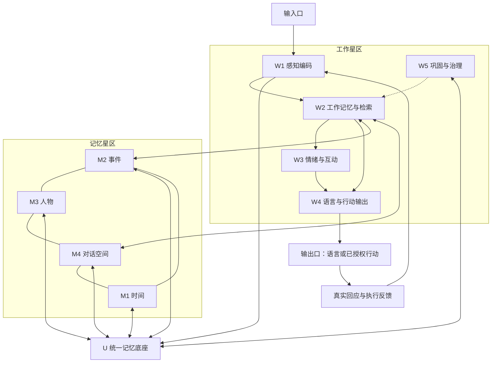

# Thinkstar 记忆星图 V5：工作星区、四类记忆星区与统一记忆底座

2026-11-22 维护补充（0.7.2）：完整短原话已无损冷存、且再次整理不会改变正文或层级时，不再重复列入计划；摘要比例或来源变化后重新评估，低价值残迹与后续到期退出仍遵循原规则。完整原话、重要保护、群聊策略和存储结构2保持兼容。

2026-11-22 维护补充（0.7.1）：中文分词与热路径统计减少重复计算，后台目录交接四次失败后正确终结失败状态。统一底座、原话、四区组织、召回语义与存储结构2均沿用现有实现；配套扩展只修正回执、日期计算及可选只读扫描等待，详见更新记录与扩展说明。

更新日期：2026-11-15，对应 Thinkstar 0.3.11（记忆业务绑定见第19节，视觉更新见第20节，替代边界与性能见第21节，单一角色见第22节，内嵌加载见第23节，面板收起见第24节，默认显示见第25节，会话预算与回执见第26节，隔离验证见第27节，原话回查与协同修复见第28节，存储去重与按月垃圾桶见第29节）。保留 V5 完整架构、研究依据与原有设计细节；根据已经完成的程序加入三层原文归档、增量压缩缓存、事实键、BM25、上下文洞察和 Aurabot 原生兼容。原 V5 已另行完整备份。本文区分设计目标与当前实现；当前实现及适配限制以第19至29节为准，不把全部研究建议和扩展验收视为已完成。经用户授权，Thinkstar 已安装到 Aurabot 并导入只读历史快照，内置记忆模块继续独立运行。

**本次关键保留政策：普通遗忘默认只降低活跃可达性，L0 原文无损保留；L1/L2 仅为导航。真正明确删除才抹除应用可读来源并播放流星。** 原文接收到之前已经缺失、截断或明确删除的细节不能恢复。

## 1. 与最初方案相比，哪里延续、哪里偏离

最初总结明确要求：统一管理器之下，时间、事件、人物、对话区分别有组织、局部摘要、索引与权重；原始证据和版本共享。这里的“区间”按初稿解释为不同群聊、私聊、会话空间，本文统一称“对话空间”，与时间区间、人生阶段区分。

V3/V4 延续了重要保存、来源统一和多入口检索，但把四个区块降为了经历区内的索引/视图，又将工作调度、情绪处理、经历存储、知识组织放成七个平行星区。底层虽提出共享证据，顶层没有把完整记忆与四区组织讲清楚。这是结构上的明显偏移；并非最初方向需要推倒重来。

| 方面 | 最初设想 | V3/V4 的问题或补充 | V5 的决定 |
|---|---|---|---|
| 一级分类 | 有管理器与四类记忆区 | 工作、存储、组织职责混列 | 分成工作域、记忆域，两域共享统一底座 |
| 时间/事件/人物/对话空间 | 独立逻辑组织，各有局部能力 | 被弱化成区内维度/过滤器 | 恢复四区的专门组织、摘要、索引、路由和权重 |
| 统一存储 | 同一证据、ID 与版本 | 有共享证据概念，完整对话归属不清 | 完整对话、经历包、事实与派生状态统一管理 |
| 一段经历的完整性 | 可以沿摘要和事件回到来源 | 层级增多，看起来像只剩碎片 | 连续原文与完整经历包并存，碎片是可回到上下文的读取单元 |
| 人类式记忆 | 借鉴记忆形成和遗忘 | 已增加情节、要旨、印象、熟悉感等 | 保留这些表征，并补熟化/隐式影响层 |
| 近期聊天 | 不能被长期设计拖累 | V4 已补即时读写、状态与未完事项 | 完整继承；全部有统一归属，不再看成五个散库 |

**最终结构：5 个工作星区 + 4 个记忆星区 + 1 个统一记忆底座。** 熟化记忆是记忆域内部的共享层，不额外增加同级星区。数量是工程组织选择，不与真实脑区一一对应。

## 2. 两类星区怎样分工

工作星区回答“现在怎样理解、想起、评价和表达”；记忆星区回答“过去的内容怎样组织、从哪里进入”。统一底座回答“准确内容到底存在哪里、当前版本与来源是什么”。

| 层次 | 组成 | 长期保留的主要内容 |
|---|---|---|
| 工作域 W | W1 感知编码；W2 工作记忆与检索调度；W3 情绪评价与互动；W4 语言表达与行动输出；W5 巩固与元记忆治理 | 配置、检查点、必要运行状态与审计；不各自维护另一套历史事实 |
| 记忆域 M | M1 时间；M2 事件；M3 人物；M4 对话空间 | 各自的目录、层级组织、局部摘要、专门索引、范围与检索策略 |
| 统一底座 U | 规范原文、完整经历包、准确声明、版本、证据、熟化关联、未完事项与派生状态 | 同一内容的权威记录及保护依赖；可分热/温/冷层 |
| 记忆域内部熟化层 | 有来源的情境偏好、图式、回应习惯、技能/策略和情感关联 | 不必逐次讲述往事也能参与当前回应的模式，仍然可查看、纠正和撤回 |

W2 的“工作记忆”确实有短时保存功能。这里将它归工作域，是因为其主要职责是当前操作，不声称工作与记忆在生物脑内存在严格不重叠的边界。W3 的当前情绪评价属于工作；过去的情绪经历与学到的回应方式属于记忆。



图只示意组织与部分允许通路。W2 可以调用任一记忆区，也可按明确 ID 直接读取 U；不要求每轮遍历四区或调用五次模型。熟化层在四区内部呈现，其规范内容也在 U。

## 3. 统一记忆底座：完整内容的共同归属

### 3.1 统一的含义

U 是逻辑上统一的记忆库、ID 空间、版本/证据管理与读写接口。初期可以由 SQLite 配合文件/媒体档案实现，之后按容量分层。统一不要求所有东西塞进一张大表、每次加载全库，也不等于只有一份物理副本；可靠备份和受控缓存仍然需要。

同一条原消息在规范层只维护一个权威对象。四区保存其索引、结构与引用，不复制四份可分别改写的事实。事实、摘要、OCR/ASR、模型推断各是不同的带来源对象，不混成同一段可随意覆盖的正文。

### 3.2 三层内容共同保留

| 层级 | 保存什么 | 对完整性的作用 |
|---|---|---|
| 连续原文层 | 消息顺序、说话人、时间、回复/引用关系、附件、修订和真实送达状态 | 无需等事件识别成功，就能续聊并展开原始上下文 |
| 完整经历包层 | 一个目标/经历的起因、过程、转折、结果、未决事项与有序来源 | 将跨轮甚至跨天的片段组织成可追溯的整体 |
| 准确声明与理解层 | 事实、偏好、约束、要旨、印象、图式、策略、情绪关联与意图 | 快速调用相关内容，仍可返回经历包与原文 |

以上可以并存。普通内容允许按价值降级，重要内容保留最小充分精确底层。经历包不是凭空补齐的故事；起因或结果不明就标未知。

### 3.3 连续对话对象

每条消息使用规范 `message_id` 与会话内 `sequence`，保存 `persona_id、scope、chat_id、thread_id、speaker_id、occurred_at、recorded_at、reply_to、source_revision、payload_ref、delivery_status`。

`ConversationStream` 保存有序消息索引和授权范围；`ConversationSegment` 指向一段或多段明确来源跨度，可标识当前话题和挂起话题。分段是组织索引，不剪断原始顺序。没有明确 thread 的平台可以先用会话序列与带置信依据的话题关联，不虚构平台讨论串 ID。

用户消息、助手草稿、已发送回复、工具实际回执分开存。原文与派生摘要的版本关联明确；后台摘要不能成为恢复近期状态的唯一依据。

### 3.4 完整经历包

`ExperienceBundle` 至少包含：

- 统一 experience_id、所有者/范围、创建与修订版本。
- 已知起点、发生时间范围及时间精度、背景和参与者。
- 按来源顺序排列的消息跨度、附件和子情节引用。
- 明确目标、关键决定、约束、转折、纠正与真实结果。
- 未完成事项、相关人物/项目、缺失内容与争议。
- 摘要、准确声明引用、重要性/保护理由、必要证据与定位入口。

同一项目的多次讨论可归一个上位经历或项目，再保留各次实际事件。跨私聊/群聊的来源各保留权限；上位经历的摘要和可见字段也按调用范围过滤，不能借“完整”绕过原有范围。

### 3.5 同一段经历在四区里的样子

示例仅为设计场景：“周五在群 A 里，小林说周日去吃火锅；周六又改到下周。”

U 保存两次真实消息与计划修订。M1 组织周五/周六的讨论时间、原计划和新计划的有效时间；M2 保留聚餐计划的完整进展与未决状态；M3 在小林的相关经历中引用；M4 在群 A 的连续对话中保留消息顺序。

四区都能进入同一经历；不能因此计成四件独立发生的事情，也不能因为计划出现过就记成已经吃过火锅。

### 3.6 内容、组织与运行状态的边界

| 对象 | 权威归属 | 四区/工作域如何使用 |
|---|---|---|
| 原消息/真实回执 | U 的规范证据 | 四区按 ID 引用；W 按需读取 |
| 事件/经历包 | U 的规范内容 | M2 负责主要组织，其他区交叉引用 |
| 人物事实/偏好 | U 的声明、版本和证据 | M3 维护人物档案与适用情境 |
| 时间线/会话目录 | U 管理的组织对象 | M1/M4 提供专门索引和局部摘要 |
| 熟化模式/情绪关联 | U 的可修订派生对象 | 记忆域按条件组织；W3/W4 使用 |
| 当前会话状态/未完事项 | U 中可恢复的状态与意图对象 | W2 是活跃工作面；M2/M4 提供恢复入口 |
| 本轮候选/临时上下文 | W2 的运行状态 | 退出窗口不删除 U 中内容 |

## 4. 四个记忆星区：各有内部组织与检索能力

四区是专门组织模块，不只是四个标签。每区都有自己的目录、局部摘要、索引、查询接口、候选策略、缓存与健康检查，同时共享 U 的规范事实。它们允许重叠，不是互斥的四个存储桶。

### M1 时间记忆星区

主要回答：什么时候、之前之后、那一阶段发生过什么、一个事实现在是否仍有效。

- 层级：年/月/日→阶段或里程碑→事件与消息跨度；层级可跳转，明确关键词不必从年摘要逐层下钻。
- 专门组织：时间线、阶段目录、重要转折、同一对象随时间的变化轨迹。
- 区分发生时间、记录时间、有效时间和计划时间；保存时区与时间精度，不给模糊时间编造精确日期。
- 索引：时间范围、主体、阶段、顺序关系、当前/历史版本与重要低频入口。
- 局部摘要：阶段经历和变化，附所覆盖的来源范围、遗漏说明与版本；摘要不能替代重要原文。
- 权重：时间匹配、阶段匹配、顺序依赖、当前任务相关性；年龄只影响普通可达性，不淘汰重要内容。
- 返回：有序候选、关键变化、有效版本与原文/经历引用；可以展开之前/之后的必要上下文。
- 典型接口：`queryTimeline`、`getChanges`、`resolveTemporalCue`。

人生阶段或项目阶段是时间组织；“对话空间”仍单独由 M4 管理。

### M2 事件记忆星区

主要回答：发生了什么、为什么讨论这件事、经过与结果、后来怎么了、还有什么没完成。

- 层级：项目/共同经历→具体事件→子情节→有序来源；自然中断不意味着经历结束。
- 专门组织：完整经历包、目标与过程、转折、更正、结果、相似事件的可核对关联。
- 索引：事件名/别名、目标、物件/作品、参与者、未决问题、关键原话、真实执行状态。
- 局部摘要：事件骨架与必要细节两层；有计划无结果就保存为未完成，不能概括成已完成经历。
- 权重：目标/事件匹配、进展依赖、里程碑、误丢代价与独特性；情绪加分有上限。
- 返回：完整经历的相关部分、状态、关键声明及来源；精确问题可直达底层，不被顶层摘要漏项挡住。
- 典型接口：`queryEpisodes`、`openExperience`、`getOpenLoops`。

事件的起因、参与者、时间与结果可能不完整；字段缺失保持未知，不依靠语言模型编故事。相关或共现也不自动建立因果边。

### M3 人物记忆星区

主要回答：是谁、怎样称呼、说过什么、明确偏好和边界是什么、有哪些共同经历与变化。

- 层级：人物身份/别名→已确认事实与明确偏好→经历目录→情境印象/关系与修复记录。
- 专门组织：身份档案、关系事实、交流偏好、个人目标、共同经历、带条件和反例的印象。
- 索引：账号/身份、别名、参与事件、适用场景、事实版本、支持与反例根。
- 局部摘要：带范围和时间的人物卡；区分明确自述、他人转述与模型推断。
- 权重：身份匹配、场景适配、独立支持、相关性；接触次数和喜欢程度不替代事实证据。
- 返回：当前适用的必要事实、代表经历、缺失/冲突与来源；不每轮装入整张人物传记。
- 典型接口：`queryPerson`、`getApplicablePreferences`、`getSharedExperiences`。

同名不强行并号；角色设定、机器人自己的配置与用户经历分开。人物摘要、缓存、图边和概括都按权限范围分开维护，不能先生成跨私聊/群聊的混合卡再只过滤原文。

### M4 对话空间记忆星区

主要回答：在哪个群/私聊说的、当时大家在聊什么、刚才那句指什么、该空间有什么共同语境。

- 层级：平台/人格可见范围→群聊/私聊→真实讨论串或带来源的话题链→连续消息。
- 专门组织：有序对话、活跃与挂起话题、空间中的人物/事件、共同简称/梗、未完事项入口。
- 索引：chat/thread/message ID、序列范围、回复/引用、实际发送者、话题链、空间约束。
- 局部摘要：该空间的当前话题/阶段语境，不等同全局人物印象；关键更正和原文指针单列。
- 权重：空间匹配、对话连续性、指代证据与话题相关性；不能把更热闹的群当作更重要的人生内容。
- 返回：完整必要对话链、当前状态、附近相关消息及其事件入口；不只给孤立的一句摘录。
- 典型接口：`queryConversation`、`readConversationSpan`、`resumeTopic`。

M4 是近期聊天的首要组织入口之一，原始正文仍在 U。窗口结束只降低常驻程度；跨两小时或隔夜不自动删除未完项目。获准综合多个空间时逐源核对，不把两处发言拼成一场实际对话。

### 4.5 四区互相连接，查询可以从任一入口开始

| 已知线索 | 首选入口 | 常见后续 |
|---|---|---|
| “刚才那个”“接着聊” | M4 + W2 当前状态 | 必要时展开 M2 的未完事项 |
| “去年那阵子” | M1 | 定位 M2 的具体经历，再核对 M3/M4 |
| “小林之前怎么说的” | M3 | 展开 M2 与 M4 的原始发言 |
| “那次聚餐后来怎样” | M2 | 核对 M1 的进展与 M4 的真实结果 |
| “群 A 里上个月小林提的店” | M4 范围 + M1/M3 线索 | 用 M2 汇总经过，再直取 U 的店名证据 |
| 只有原话稀有词或明确消息 ID | U 的直接入口 | 找到原文后反查四区组织 |

专门索引可在一次数据库查询中联合使用，逻辑上的跨区不要求多次模型调用。没有人物或时间线索时允许词法/语义入口；不强制四区依次走一遍。

## 5. 五个工作星区：处理发生在这里

### W1 感知与编码

接收文本/图片/音频和真实回执，识别发送者、范围、原话/转述/计划/纠正，分配规范消息 ID。先可靠提交原文、必要引用和 outbox，随后即可读取；复杂事件识别与多模态解释可以稍后补齐。明确保护信号立即临时保护，不等模型打分。

机器识别文本与原媒体分开；识别失败有状态。输入过长可分块索引，不能因模型注入预算把原文固定截成前 500 字。用户明确不允许记录、已删除或超出范围的内容仍执行相应规则。

### W2 工作记忆与检索调度

维护本轮问题、当前话题/指代、最新选择、更正、未完成事项、相关证据和上下文清单。优先使用已提交近期原话与可恢复状态；不等待后台摘要或 embedding。按线索调用 M1—M4，必要时直接读取 U。

查询过程区分在库、命中、候选、入上下文和实际使用。近期状态、必要对话链和本题长期证据有软预算并可互借；重要但无关的旧事不必常驻。宿主已有消息按 ID 去重。超窗口时先移除非必要材料，再分阶段读取；不无声截掉关键条件。

`ConversationState` 持久化在 U，包括范围、revision、last_applied_sequence、当前/挂起主题、活跃实体/版本、明确选择/否定/更正、open_loop_ids、真实工具/发送状态、共同语境、来源引用和未定字段。确定性变更按差量处理；复杂理解可异步补充，但基本续聊有原话兜底。

### W3 情绪评价与互动选择

当前输入先作低成本初评，再结合读到的真实经历、偏好、目标和不确定性选择回应方式。可以接话、共情、分享、帮助、温和不同意或自然结束；不要求每轮走固定安慰模板。

当前评价是工作状态；过去的情绪经历、被认可的支持方式、条件化回应关联在 U 中保留，并由 M2/M3/M4 组织和熟化层提供。W3 不另建脱离原文的“情绪事实库”。用户自述、系统推断和角色表达变量分开。

### W4 语言表达与行动输出

根据当前工作包、人格、共同语境和互动策略生成自然表达，选择隐式适应、轻量承接或明确回忆。保持称呼、指代、语气和话题衔接；需要精确回忆时保留数字、条件与来源。

动作提议、实际执行、成功回执和实际投递分开。发送前核对更新的选择、更正与取消事项；外部主动联系和工具执行继续服从已有授权。W4 不把草稿写成已经发生的经历。

### W5 巩固与元记忆治理

后台处理新增/受影响内容：经历归组、准确声明与证据对齐、版本/冲突、四区局部摘要与索引、熟化模式/情绪回应学习、压缩归档、索引健康和恢复。

它管理保护依赖、交接状态、重试和容量，检查“到底知道多少、缺哪部分”；不靠模型一句“我记得”判断库存。前台核验使用轻量规则，不要求等整套后台治理跑完。任务短事务、小批次、可恢复；重要交接保留服务机会，低价值丰富化先让路。

五区是职责边界，不等于五个独立智能体、五个 LLM 或五轮串行推理。W2/W3/W4 可在同一次生成中使用一份有来源的工作包；规范来源和运行事件足以审计，不记录模型隐藏思维链。

## 6. 熟化记忆与“潜意识”：让记忆自然影响回应

### 6.1 心理学启发与工程定义

人类记忆研究区分工作记忆、长期记忆，以及显性/陈述性与若干隐性/非陈述性形式；习惯、技能等可以在不主动回忆具体事件时影响表现。参见 [Squire & Dede, 2015](https://pubmed.ncbi.nlm.nih.gov/25731765/)；工作记忆对多来源信息的临时整合参见 [Baddeley, 2000](https://pubmed.ncbi.nlm.nih.gov/11058819/)。这些是功能参考，不能推出系统具有人的潜意识体验。

V5 将用户提出的“成为潜意识”落实为记忆域内部的熟化层：在适用情境中自然影响称呼、接话、策略与表达，无须每次明确讲出来源故事。明确陈述的偏好也可以这样使用，但这不说明它在心理学上自动变成隐性记忆。

### 6.2 熟化层保存什么

| 内容 | 形成依据 | 使用方式 |
|---|---|---|
| 明确的回应偏好/边界 | 本人直接说明，保留范围与版本 | 适用时直接遵守，不必反复追问或宣布在用记忆 |
| 共同语境与熟悉称呼 | 实际对话与身份关系 | 简短自然地续接，避免解释双方都知道的前情 |
| 情境化互动模式 | 多次独立经历或明确反馈，保留反例 | 当前条件匹配时提供有限策略建议 |
| 图式/经验脚本 | 跨事件归纳，注明适用范围 | 帮助理解与检索，不覆盖相反事实 |
| 技能/行动策略 | 实际成功/失败记录和验证条件 | 为当前任务提供可检验步骤，不冒充已执行 |
| 情绪意义关联 | 有来源的情绪经历、明确反馈与修复 | 参与 W3 当前评价，不增加事实可信度 |

`LearnedPattern` 包含对象/范围、触发条件、模式内容、来源根、支持/反例、有效时间、版本、学习来源、适用强度与保护状态。自动学到的模式与固定人格卡分开；相关证据撤回或删除时，派生模式同步失效或重算。

### 6.3 熟化、冷藏、熟悉感分开

- 熟化：一种经验如何参与当前表现，不必伴随明确讲述。
- 冷藏：正文或索引放在哪个存储层，仍可保留非常准确的记录。
- 熟悉感/识别：本次找到了曾出现的可核对线索，但可能缺乏具体细节。
- 要旨化：允许有损的内容只剩大意，不能再声称逐字回忆。

重要经历可以同时有完整原文、准确声明和熟化影响。形成习惯、印象或“已经懂了”都不是删除重要证据的理由。熟化层也不应变成不可检查、无法纠正的黑箱。

## 7. 输入—处理—输出与可靠交接

### 7.1 写入：先有整体，再丰富组织

1. W1 以消息 ID/序列去重，原文、范围与 outbox 原子提交；重要候选暂时保护。
2. 提交后 W2 和 M4 立即能按序列读取，更新必要当前状态；即使事件尚未识别也能继续对话。
3. W5 后台为来源跨度建立或更新经历包，抽取准确声明并对齐关键字段。
4. 根据内容增量更新 M1—M4 的专门组织、摘要、索引和必要熟化关联；全部引用同一 U 内容。
5. 校验保护依赖与至少一种可用定位入口后完成交接；可去掉重复热缓存，必要保护原证据继续保留。

重要交接状态：`accepted_durable → protected_pending → extracted_aligned → canonical_committed → lookup_available → handoff_verified`。向量未完成不阻止可用 ID/词法入口交接。普通/低价值内容允许标记不入长期；不能为永久处理全部水聊堵住前台。

### 7.2 读取：片段定位后回到必要整体

1. W2 识别当前问题与已知线索，先看宿主已有历史、近期原话、当前选择与未完事项。
2. 按范围/身份与版本门控，在相关记忆区获取小规模候选；精确 ID、原话和稀有词可直读 U。
3. 候选返回所属经历、来源跨度、关键字段与缺失信息，不能只有失去上下文的一句向量片段。
4. 根据指代、因果背景、否定、纠正和结果的依赖，展开必要原文与经历包；排除不相关邻居。
5. W3 按需评价，W4 自然回应；输出核验与证据精度匹配。
6. 真实反馈和执行结果回到 W1/U，触发需要的状态/学习更新。没有反馈仍为 unknown。

四区都可能返回一个 memory_id；先按规范 ID 与来源根去重，再装配上下文。不能因重复命中虚增支持次数或重要性。

### 7.3 防止“切碎后只剩碎片”

| 风险 | 设计要求 |
|---|---|
| 检索只拿到“用旧的” | 返回回复/引用对象、相关前文与当前选择版本 |
| “别用 A，改 B”被切成两条冲突事实 | 同一声明/纠正链保留条件、否定与 supersedes |
| 把一段长对话切成固定小块 | 小块只作读取索引；完整原消息、顺序和经历关系保留 |
| 物理相邻却在聊不同主题 | 扩展依据话题/回复与声明依赖，不机械取前后固定条数 |
| 一个主题跨天或中间插话 | 允许多个有序来源跨度归同一经历，保留中断与恢复 |
| 四区摘要互相矛盾 | 摘要携带源 revision/coverage；旧投影失效，从规范版本重建 |
| 将多群资料拼成“当时的对话” | 逐段标来源空间和实际时间，分别核对范围 |

查询时可以只用足够的小部分；组织层保证有路回到仍然保存的整体。普通活跃表征按规则有损降级时，明确剩余精度；0.3.0 默认同时保留独立可读的 L0 原文，因此可以回查真实原话。上游未采集、原已截断、明确删除以及主动关闭原文保留策略后的实际缺失仍不能补造。

## 8. 近期连续性、长期留存与前台预算

### 8.1 V4 的五种结构统一归位

| 结构 | 在 U 中的归属 | 主要组织/工作入口 |
|---|---|---|
| 即时原话窗口 | ConversationStream 的最近规范消息与受控缓存 | M4 + W2 |
| 当前会话状态 | 版本化 ConversationState / 差量与检查点 | W2 使用，M4 恢复 |
| 未完成事项账本 | ActionIntent / open_loops 与来源 | M2/M4 组织，W2 使用 |
| 近期事件缓冲 | 尚在完善的 ExperienceBundle 与来源跨度 | M1/M2/M4 |
| 长期重要记忆 | 准确内容、版本与最小充分保护包 | 四区按线索进入 |

它们是同一底座上的不同用途与投影，不是五份聊天库。短期到长期主要改变保护、结构、索引和冷热状态，不需要剪切搬运后立即删除唯一原文。

### 8.2 必须保持的连续性

“先 A”→“换 B”→“继续”的当前选择为 B；旧 A 作为历史。明确换题挂起原话题，不强拉回来；重新提起时按线索恢复。重要未完事项跨两小时、跨天仍可查，不因短期印象过期而自动完成。

重启从规范日志与检查点按 sequence 重放；摘要不是唯一恢复源。人格、空间与 thread 覆盖缓存、图边和后台任务，旧任务写回入队时的范围。用户在生成中追加更正时记录 revision，按宿主 steering/排队契约处理，并在输出/行动前检查重要变更。

`ContextManifest` 记录宿主已含 message_ids、摘要覆盖区间、范围与实际模型余量。只补缺失近期链、准确状态和本题长期证据。宿主接口不提供完整清单时明确适配限制，不能靠文本相似把关键更正误删。

### 8.3 预算是软份额，不是历史存储上限

先扣除系统/人格、工具、当前输入、宿主现有历史和输出预留，才知道可用记忆材料预算。若真实余量允许 8192 tokens，可试验：

| 材料 | 软目标 tokens | 取舍原则 |
|---|---:|---|
| 宿主缺失的最近完整往来 | 4096 | 保留必要完整链，长消息按准确声明与来源展开 |
| 当前状态与未完事项 | 1024 | 最新选择、关键更正/否定不被背景挤掉 |
| 本题长期重要事实与证据 | 2048 | 精确历史查询按需扩大，与近期份额互借 |
| 共同语境、相关回应偏好与少量联想 | 1024 | 无需要不填满，优先让给必要证据 |

最近 12 轮、64 条热缓存、72 小时近期缓冲仅是受容量约束的实验起点，不是每轮必装数量或自动删除期限。未完重要事项、待交接重要来源与保护内容不随缓存窗口淘汰。

### 8.4 后台可以让路，也需要完成重要交接

前台可靠接收、近期读取和本题必要证据优先；后台分块、短事务、检查点、可重试，模型与 embedding 有独立预算。持续忙碌时先暂停低价值丰富化，为重要交接保留小批次服务机会。观察积压数量、最老待交接年龄、锁等待和磁盘余量，服务能力不足时明确降级。

多群公平配额防止单个热闹群挤掉其他会话的近期能力；内存不足先减显示、重复缓存与低价值联想。SQLite WAL 改善部分读写并发，但仍有单写入者等限制，需避免全状态 load/save 与长事务。[官方说明](https://sqlite.org/wal.html)

## 9. 重要识别、保护和容量取舍

### 9.1 重要不是热门，也不是情绪强烈

P0 明确保护、P1 重要、P2 普通、P3 低价值。保护先于普通加权排序；可信度、访问热度、熟悉感与重要性分开。保护一条推断/转述，只代表保存带来源的说法，不将其升级为已证实事实。

`ImportanceCandidate` 保存对象/范围、内容/证据、重要理由、误丢代价、未来用途线索、保护等级、判断来源与待核验状态。明显信号即时保护；复杂语义后台增量判断。分类难明的来源先有近期缓冲，不能把一次模型未选中当作立即删除的充分依据。

| 内容 | 处理 |
|---|---|
| 明确要求记住、重要边界、更正 | 立即保护必要原文与准确字段 |
| 项目约束、关键数字/单位、决定和未完承诺 | 保护条件、版本、状态与证据 |
| 身份/关系变化、重要共同经历、长期目标 | 保存具体经历与有来源的重要判断 |
| 只说一次、语气平静、罕见但误丢代价高 | 按损失与未来用途保护，不设访问次数门槛 |
| 意义暂不明的小经历 | 近期保留、允许追认重要后补齐前因 |
| 重复回执、无新增信息与寒暄 | 低成本近期使用，允许不进长期 |

### 9.2 最小充分保护包

准确内容、主体/范围、时间与有效版本、数字/单位/条件/否定、必要原文、重要更正、来源根与定位信息一起保护。保护沿必要证据依赖传播，不沿全部相似/共现边保护整库。

四区只是引用这些内容，单一区块不能通过“本区配额满了”删掉 U 的保护对象。需要清理的组织缓存可以重建；必要精确入口在迁移中保持可用，不以向量重建尚未完成为由让重要信息彻底不可见。

### 9.3 同样容量下保留更多重要内容

共享来源、精确去重、无损压缩重要包、分层存储、局部目录和按需展开。相似措辞中的不同日期、条件、否定、反例与更正不合并抹平。概括提高组织效率，不替代重要精确底层。

容量压力下先回收可重建显示/重复缓存和低价值派生索引，再缩小普通活跃细节与目录。0.3.0 默认不因容量压力删除 L0；仍不足时明确拒绝未能可靠提交的新增，保留现有原话。只有操作者明确关闭原文保留策略后，旧的普通内容不可恢复淘汰政策才可启用；保护集合仍不可静默覆盖。

抽检低频重要记录、四区定位入口、来源可读性和交接完整性；失败触发修复，不把反复重读算作新增独立支持。定期报告规范正文、保护证据、普通正文、派生索引、缓存/显示和待交接积压的实际占用。

## 10. 多维记忆状态与印象

以下沿用 V4 的六维分类。它们描述 U 中记忆和本次提取表现；四个记忆区都可包含这些形式，不再为每种状态另设一片同级星区。

六个维度各有独立字段。它们可以组合，不是一级升到另一级的“人脑等级”。

### 维度 A：表征形式——保存成了什么

| 表征 | 含义 | 允许使用方式 |
|---|---|---|
| 原始证据 | 有原消息、图片、音频或真实回执 | 对相应来源作准确引用；不保证来源所说都是真 |
| 精确事实 | 有主体、条件、时间的结构化声明 | 在适用范围作答，必要时展开证据 |
| 情节回忆 | 具体事件及谁/何时/何地/过程 | 回答相关经历，不拼接成未发生事件 |
| 要旨/大意 | 只保留内容主旨 | 可概述，不能装作有逐字原话 |
| 暂时印象 | 从少量材料形成的情境化假设 | 作为低确定性回应参考，并可检查依据 |
| 稳定图式/脚本 | 跨事件的较稳定模式 | 指导预测和检索，保留例外与适用条件 |
| 程序/策略 | 如何做、何时适用、如何验证 | 用于操作提案和流程选择 |
| 情绪/评价关联 | 某场景和某种反应/偏好的联系 | 由 W3 读取后参与评价，不代替事实 |
| 未来意图 | 承诺、待办、条件计划 | 由 W2/W5 检查触发条件，W4 按授权输出；不当成已经经历过 |

同一事件可以同时有情节、要旨、印象和情绪关联，彼此用带证据的边联系。

### 维度 B：提取表现——本次能想起多少

| 显示状态 | 后端可检查的条件 | 后续动作 |
|---|---|---|
| 当前聚焦 | 已选入本轮工作记忆 | 使用并保留来源 |
| 可直接取回 | 已索引且按当前线索找到充分内容 | 按需加入，未用则不强化 |
| 线索唤起 | 通用查询未命中，但由别名、场景或目录定位 | 展开相关事件/冷档 |
| 部分回忆 | 只找到人物、场景或部分声明 | 明确缺失字段，做一次受限补查 |
| 识别/熟悉线索 | 有曾出现的可核对记录，但无足够情节细节 | 只能说知道提过，不能补原话 |
| 暂时不可及 | 目录显示正文尚在，但本次预算、索引或错误阻止取回 | 标原因，允许深查或修复 |
| 当前无依据 | 当前范围内没有找到可用支持 | 说不确定；不能据此证明从未发生 |

“原文已删”“未收录”“范围不许访问”属于存储/权限事实，应单独说明，不能混成暂时想不起。识别/熟悉线索的工程定义来自可核对目录，不以向量高分或模型语气作判据。提取状态绑定 query_id 与本次检索，不永久贴在记忆上。

### 维度 C：来源与证据——凭什么这样说

来源类别：本人直接陈述、第三方转述、真实工具记录、外部文献、角色定义、模型推断、系统摘要、假设/模拟。保存 origin 与独立 support_root，不能互相升级。

证据状态：已对齐原文、仅有摘要、待核验、相互冲突、已被反证、源已缺失。证据置信度和声明真实性分别评估；原话存在只能证明原话存在。

“听说过”“我推测”“这个人自己说过”“工具确认成功”在输出层有不同措辞。模型未经校准的分数不标成真实概率。

### 维度 D：时间有效性——现在是否仍适用

未来生效、当前适用、仅历史适用、已被更新、被明确撤回/纠正、时间范围不确定。存 occurred/recorded/valid 时间及精度。旧事实可以作为历史准确存在；冷藏与压缩不改变有效性。

### 维度 E：存储状态——东西还在哪里

完整热存、完整温存、可无损展开的冷档、要旨并附可读原文、仅有有损要旨、退出活跃层但 L0 仍保留（archive_only）、仅有外部位置目录、正文丢失但有残留线索、已彻底淘汰。

外部位置可能失效，目录需健康检查。hash、关键词或 Bloom filter 不会恢复已删正文。“仅剩大意”属于有损保存，“当前取不出”属于查询表现，二者不能混淆。

### 维度 F：保存优先级——允许丢到什么程度

P0 明确保护；P1 重要；P2 普通；P3 低价值。受保护的不是某一行摘要，而是关键字段与必要证据依赖。可达性、熟悉度、负面情绪、曝光次数都不能单独解除或产生永久保护。

### 一个记忆节点的组合示例

“有一次你说难过时更想先被倾听”：表征=要旨+情境偏好；提取=部分回忆；来源=当时自述的派生概括；时间=偏好有效范围待复核；存储=原文已缺、概括仍在；优先级=P1。

正确行为是据已有概括谨慎调整回应，并说明无法逐字引用。若它本该从采集时就受保护却丢失证据，记为保护失败并修复，不能把失败合理化成“人类式遗忘”。

### 10.7 印象与熟悉感的具体区分

日常语言中的“有印象”至少包含四种不同事物：

1. 熟悉/识别：见过这个人、词或话题，但缺乏事件细节。
2. 要旨：知道大意，但不记得精确措辞或数字。
3. 人物/情境判断：觉得某人可能偏好某类回应，是可撤回假设。
4. 情感联想：某个场景带来温暖、紧张或担心的表达倾向，不证明事件因果。

前三者由 U 保存、四区组织，由 W2/W5 判断来源与可提取性；第四者也在 U 中保存，由 W3 读取使用。不能用统一 impression 字符串替代全部。

#### 印象的形成与修订

单次事件先进入完整经历包；熟化层可形成带条件的暂时假设；独立支持、明确自述或反例到来时更新适用范围；跨事件稳定后可成为图式，但仍能修订。

这不是必须经历的线性阶梯。一次明确的“以后别公开提这件事”立即成为受保护边界，不等待多次观察；旧稳定印象也可能因有力更正而直接缩小范围。

支持次数按来源根和场景覆盖计算。十次模型复述不是十次证据。反例权重根据相关性、来源和情境判断；不能机械复制“负面行为比正面行为更能定义人”的偏差。

重要精确记忆即使同时形成要旨，也不能只因“概括已经够像”而删掉精确底层。允许同时存在“准确记录”和“对它的意义理解”。

## 11. 当前情绪工作与情绪记忆分开

W3 负责当前评价和互动建议；历史情绪经历、回应反馈和学习关联在 U 中保存，由相关记忆区与熟化层组织，W5 后台更新。评价状态与学习内容不再混为一个同级区域。

### 11.1 两次不同深度的评价

- 初评：从当前输入识别明确情绪词、突发变化和是否需要优先关注，结果短时、低成本、可撤销。
- 读后复评：结合实际取回的经历、关系事实、偏好、目标与不确定性，形成当前回应建议。

不把所有情绪都延迟到检索结束，也不让初评绕过事实核验直接写成长期判断。当前输入与旧记忆矛盾时优先调查，而非强迫新信息符合旧情绪。

### 11.2 情绪学习数据结构

| 字段 | 示例 |
|---|---|
| context | 对方明确说今天很累 |
| user_state | 本人自述疲惫；不是模型诊断 |
| retrieved_context | 过去明确表示累时不想被连续追问 |
| appraisal | 目标=理解与支持；确定性=较高；需要低打扰 |
| response_strategy | 简短回应，允许暂停，不连续问问题 |
| observed_feedback | “这样就好”；若无回复则为 unknown |
| support/counterexample | 对应原话与不适用场景 |
| scope | 该用户私聊、疲惫情境；不能推广全群 |

学习结果用于情境策略，不给人物贴“脆弱”“难相处”等全局标签。角色表达的开心/担心是派生状态，随新证据可重评，不写回用户情绪事实。

### 11.3 三条时间尺度

瞬时情绪/表达状态：通常随本轮与当前情境消退。

阶段状态：明确“最近很忙/这一阶段不想多聊”等，按有效区间和新证据更新。

长期情感意义/回应偏好：重大共同经历、明确边界、被认可的支持方式；可以长期保护。

时间尺度不预设统一天数。短时情绪衰减不删除重要事件；长期关系也不意味着每轮都提起旧事。

### 11.4 反刍与偏差控制

同一负面事件被反复自动检索，不自动扩大人物负面评价。记录“本轮使用”但不增加独立支持；识别已回答/已处理的重复线索，除非用户重新要求，不无休止重放。新的明确修复反馈可以改变当前评价，保留历史事实。

情绪不支配权限、事实置信度或重要保护。当前觉得不安时仍允许检索中性和相反证据；边界和行为约束优先于亲密感。不能以用户沉默降低关系价值或施加情绪压力。

## 12. 自然聊天：记忆用来接住话题

此前只读检查确认 Aurabot 有相处经验、说话方式学习、人物/群印象、自然使用记忆的提示、人设、心情和消息解析发送。以下是对现有基础的细化与整合，不作为从零新增同名系统。

### 12.1 后台精确与日常表达分离

存储和检索保留事实、来源、条件、时间与反例。日常聊天不以每句包含最多事实为目标；允许短回应、共同语境、玩笑、停顿与自然收尾。认真讨论、查原话和技术问题时再按要求详细表达。

不把内部证据状态、置信字段和检索日志直接说给用户。需要核对时自然解释具体不确定点，用户问依据时再展开；不能为了简洁把不确定事实说得很确定。

### 12.2 记忆进入表达的三个用法

| 用法 | 行为 |
|---|---|
| 隐式适应 | 记得对方的偏好，因此自然少追问或采用熟悉称呼，不宣布在用记忆 |
| 轻量承接 | 用“上次那个”“还是那一段”等共同语境续接，前提是指代够清楚 |
| 明确回忆 | 用户问起或旧事确有帮助时展开事件、细节和来源 |

增加 `last_mentioned_at, mention_count_by_context, unresolved_followup, shared_reference, disclosure_scope` 等使用记录，避免每轮搬同一条旧事。记录“提过”不增加其独立证据数。

### 12.3 共同语境与日常痕迹

保存短期内双方正在使用的简称、梗、小插曲、作品感想和话题进展。大多归近期缓冲与共同语境，预算有限、优先级低；形成重要共同经历时再提升。它们可以在相处中起作用，不必每件都总结成永久人格标签。

### 12.4 接话与互动选择

当前回应可选择接一句、分享相关看法、陪着吐槽、一起高兴、提供帮助、温和不同意、简短确认或自然结束。不要每次完整走“识别情绪—表示理解—给建议—追问”。

追问优先指向当前关键点，考虑对方是否想展开；用户说不想讲时尊重收尾。连续短消息尽量合并理解，不对每个半句插入一条回复。任何主动对外联系仍服从已有功能开关与授权，不因这份设计自动启用。

### 12.5 稳定口吻与恰当适应

人格的基本表达方式、幽默与已有偏好相对稳定；句长、正式程度和解释深度适应当前任务与用户习惯。角色可以有自己的看法，避免一味附和，也不为表现个性故意抬杠。

温暖、担心或轻松氛围可以跨轮衔接，但新证据能改变评价。用户沉默不是负反馈；不制造敌意或情绪压力。不通过假称线下经历、故意出错或故意忘记来增加“活人感”。

### 12.6 自然修复与示例

下面是方向示例，非固定台词：

| 场景 | 可接受的表达方向 |
|---|---|
| “今天不想讲了。” | “行，今天先不聊这个。” |
| “终于弄好了！”且历史确有卡点 | “终于！上次那个卡点过了。” |
| “不是上周，是前年那次。” | “哦，前年那次，我串了。”随后真正在状态中修正 |
| 缺少原店名但确有火锅事件 | “那次吃火锅我记得，店名这会儿没找着。”若原文已失，不能承诺继续一定找到 |
| 指代不清但有一个明确候选 | 简短核对“你说上次被退回来的那版？” |

内部不故意制造错误，外部也不把简单修正变成长篇格式化道歉。

### 12.7 参数与评估变化

聊天侧主要控制：记忆显露程度、追问压力、话题主动程度、语言贴近程度。情绪表达强度保留为高级参数，不能以一个高数值替代情境适配。共同语境和近期连续性由系统维护，默认有效，不依赖用户把所有滑杆调大。

自然性评估看连续多轮的接话、记忆提起时机、口吻稳定、问题负担、重复套路、话题收尾与事实一致。加上直接问答与自然融入双重测试；自然融入不能只用检索 Recall@k 代替。[MemUse](https://aclanthology.org/2026.emnlp-main.804/)

补充依据：[消息交互性](https://doi.org/10.1016/j.chb.2019.01.020)、[具体而低负担的对话修复](https://doi.org/10.1371/journal.pone.0136100)、[语言风格匹配](https://pubmed.ncbi.nlm.nih.gov/21149854/)、[回应延迟的情境差异](https://doi.org/10.1007/s12599-022-00755-x)、[社交线索元分析](https://doi.org/10.1057/s41599-025-05618-w)。这些支持候选设计方向，不证明某种口吻或固定延迟普遍最优。

## 13. 权重、信息密度与可调参数

### 13.1 四类可调量与不可调事实

节点保存重要性、保护级别、来源根、时间/有效版本、精度与真实字节数；边保存类型、依据、强度与适用范围；模块保存排序权重、预算、粒度与学习率；本轮运行保存相关性、激活、候选/实际使用、覆盖与耗时。

权重仅比较已通过范围、来源、版本与相关性门控的候选。真实性、原文是否存在、真实执行状态和用户实际反馈是核验结果，不能做成随意拉高的滑杆。重要保护、关键字段完整性和范围隔离先执行，不能被高语义相似度抵消。

### 13.2 变量具体加在哪里

| 位置 | 建议权重 | 信息密度/预算变量 | 约束 |
|---|---|---|---|
| U 统一底座 | 普通项 future_need、loss_cost、uniqueness、rebuild_cost | 普通摘要比例、分块大小、证据跨度、冷热索引预算 | 保护精确底层不可有损替代；分块不破坏原文 |
| M1 时间 | temporal_fit、phase_fit、sequence_dependency | 时间线粒度、阶段摘要覆盖、时间扩展跨度 | 时间精度是证据属性，不靠参数编造 |
| M2 事件 | goal_fit、event_fit、milestone、loss_cost | 经历包展开深度、代表事件数、必要前后文 | 关键转折/否定/纠正不可当冗余删掉 |
| M3 人物 | identity_fit、condition_fit、independent_support | 人物卡粒度、例子/反例席位、经历覆盖 | 亲密/喜欢不提高事实真实性；同名不强并 |
| M4 对话空间 | scope_fit、continuity、reference_fit、topic_fit | 连续消息范围、活跃话题数、当前状态份额 | 空间范围先门控；完整必要对话单元优先 |
| 熟化层 | applicability、pattern_gain、learning_rate | 情境细分程度、模式包大小、复核频率 | 明确边界由证据更新，不等缓慢学习 |
| W1 编码 | goal_link、loss_cost、uniqueness；情绪有限加分 | 声明拆分粒度、待核验缓冲 | 原证据接收不被抽取粒度截断 |
| W2 检索装配 | lexical/semantic/entity、相关性、多样性、证据适配 | 区块路由、候选、补查、跳数、各类 token 份额 | 精确入口与必要证据可直读，不强制四区全走 |
| W3 评价 | 当前输入、目标影响、情境适配、真实回应经验 | 相关情绪经历数、评价上下文、表达增益 | 不强化反刍、不从沉默生成负反馈 |
| W4 表达 | task_fit、style_gain、memory_explicitness | 回答细致度、追问压力、语言贴近、话题主动度 | 日常聊天不追求每句最大信息密度 |
| W5 治理 | 普通项误丢代价、未来需要、重建成本 | 小批次大小、并发、后台 tokens、积压阈值 | 重要交接不能无限饥饿，也不拖住基本续聊 |
| 星图 | 仅 display_focus_gain | 可见节点/边、标签、聚合层级 | 不改变规范存储、重要性或可信度 |

每区有独立权重组、局部摘要/索引与策略，而非给四个标签共用一套无差别查询。归一化在各组内进行，不将所有权重跨模块加成一个总和。

### 13.3 三种密度分别调

**存储密度**：去重、无损压缩、准确声明结构化，以及普通项允许多少有损概括。重要保护包不受普通压缩比例控制。

**检索/上下文密度**：相同 token 内保留多少准确事实、来源、必要上下文、反例与背景。先去同源重复，再按任务展开；不能以孤立短句很多来冒充高有效密度。

**呈现密度**：星图显示多少节点/边/标签，以及需要详细说明时回答展开多少。日常聊天长度由语境决定，图上隐藏或回答简短不减少底层保真。

建议指标：去重后声明数、来源根数、必要字段覆盖、经历上下文完整性、可定位保护包比例、每千 token 的有依据任务相关内容，以及实际回答正确率。模型自动评估属于估计，需要人工/确定性样本校验。

### 13.4 排序计算与图扩展

普通内容可用 `U_save=a*future_need+b*loss_cost+c*uniqueness+d*goal_link+e*contextual_significance` 排序，特征同尺度、组内权重归一化；P0/P1 先保护，不参与可抵消的淘汰比较。重建与字节成本由资源分配器单列。

M1—M4 的权重只在本区通过门控的候选内排序，各组先校准特征尺度；跨区合并按规范 ID/来源根去重并重新评估本题相关性，不能把不同区的原始分数直接相加，也不能因命中多个区便自动获得更高可信度。

BM25、向量与实体分数不直接相加，可用通道内名次的加权 RRF：`S_channel(m)=Σ w_c/(k+rank_c(m))`。通道关闭时重归一化，其原始分数不当作概率。

相关候选内可参考 MMR：`S_select=lambda*S_relevance-(1-lambda)*max_similarity_to_selected`；必要证据、更正和反例有独立保障，不能作为相似内容被挤掉。[作者论文](https://www.cs.cmu.edu/afs/cs/Web/People/jgc/publication/MMR_DiversityBased_Reranking_SIGIR_1998.pdf)

图激活可用 `a_next(v)=max(a_prev(v),a(u)*g_type*strength(u,v)*gamma)` 示意；激活不是事实置信度。限制语义扩展节点数、跳数和总时间，但按明确 ID 获取必要支持/纠正链不受显示 fanout 误拦；超过真实资源能力须报告不完整。

普通可达性可试用 `A(delta_days)=2^(-delta_days/half_life_days)`。半衰期只调整普通可达性/温度，不改变有效时间、可信度或重要保护。数字均为工程实验起点。

### 13.5 V5 参数模板

以下完整模板保留为设计目标，包含尚未全部接入的扩展项；不是当前程序的逐键配置文件。0.3.0 的 71 项实际参数、默认值与面板帮助以 `core/v5-config.js` 和 `core/v5-param-help.js` 为准，关键新增列于第 19 节。

```json
{
  "config_version": "thinkstar-v5-design-draft",
  "continuity": {
    "read_your_writes": true,
    "await_background_summary": false,
    "persist_conversation_state": true,
    "raw_tail_target_exchanges": 12,
    "hot_cache_target_messages": 64,
    "recent_episode_soft_hours": 72,
    "important_handoff_verified_before_source_eviction": true,
    "unresolved_important_auto_expiry": false
  },
  "retrieval": {
    "route_limit": 3,
    "candidate_limit": 60,
    "channel_weights": {
      "lexical": 0.45,
      "semantic": 0.35,
      "entity": 0.2
    },
    "diversity_lambda": 0.75,
    "max_hops": 2,
    "semantic_fanout": 8,
    "hop_decay": 0.55,
    "max_followup_searches": 1,
    "required_source_lookup_not_limited_by_semantic_fanout": true
  },
  "context": {
    "memory_pool_soft_tokens": 8192,
    "soft_allocation_tokens": {
      "recent_raw_missing_from_host": 4096,
      "current_state_and_open_loops": 1024,
      "long_term_facts_and_evidence": 2048,
      "shared_scene_and_optional_context": 1024
    },
    "respect_actual_model_window": true,
    "deduplicate_by_message_id": true,
    "precision_floor_protected": "all_required_fields"
  },
  "impressions": {
    "learning_rate": 0.1,
    "scope": "condition_specific",
    "independent_support_only": true,
    "optional_counterexample_slots": 2
  },
  "conversation": {
    "memory_use": "implicit_light_or_explicit_by_context",
    "followup_pressure": "contextual",
    "topic_initiative": "contextual",
    "style_accommodation": "bounded_by_persona",
    "density_objective_in_casual_chat": false
  },
  "affect": {
    "expression_gain": 0.4,
    "retrieval_affect_bonus_cap": 0.15,
    "feedback_learning_rate": 0.1,
    "missing_feedback": "unknown"
  },
  "retention": {
    "protected_lossy_replacement": false,
    "ordinary_access_half_life_days": 30,
    "ordinary_summary_target_ratio": 0.25,
    "low_value_recovery_priority": "best_effort_after_important_preservation"
  },
  "scheduler": {
    "foreground_memory_priority": true,
    "background_yield_between_batches": true,
    "background_concurrency": 1,
    "background_transactions": "short_bounded_and_checkpointed"
  },
  "display": {
    "visible_node_limit": 300,
    "label_density": "medium",
    "only_real_run_animation": true
  },
  "architecture": {
    "working_regions": [
      "W1",
      "W2",
      "W3",
      "W4",
      "W5"
    ],
    "memory_regions": [
      "M1",
      "M2",
      "M3",
      "M4"
    ],
    "canonical_store": "U",
    "memory_forms": "shared_across_four_regions",
    "mature_patterns_layer": "within_memory_domain",
    "canonical_identity_shared": true,
    "preserve_conversation_sequence": true,
    "preserve_experience_source_spans": true
  },
  "memory_regions": {
    "M1": {
      "organization": "timeline_and_phases",
      "local_summary": "source_versioned",
      "index": [
        "occurred_at",
        "recorded_at",
        "valid_time",
        "phase",
        "sequence"
      ],
      "weights": {
        "temporal_fit": 0.5,
        "phase_fit": 0.2,
        "relevance": 0.3
      }
    },
    "M2": {
      "organization": "projects_experiences_episodes",
      "local_summary": "source_versioned",
      "index": [
        "event_alias",
        "goal",
        "participants",
        "open_loop",
        "source_terms"
      ],
      "weights": {
        "event_fit": 0.4,
        "goal_fit": 0.3,
        "relevance": 0.3
      }
    },
    "M3": {
      "organization": "identity_facts_conditional_profiles_experiences",
      "local_summary": "scope_and_source_versioned",
      "index": [
        "identity",
        "alias",
        "condition",
        "support_root",
        "event_ref"
      ],
      "weights": {
        "identity_fit": 0.45,
        "condition_fit": 0.35,
        "relevance": 0.2
      }
    },
    "M4": {
      "organization": "spaces_threads_topics_ordered_messages",
      "local_summary": "scope_and_source_versioned",
      "index": [
        "chat_id",
        "thread_id",
        "sequence",
        "reply_to",
        "topic_ref"
      ],
      "weights": {
        "continuity": 0.45,
        "reference_fit": 0.35,
        "topic_fit": 0.2
      }
    }
  },
  "learned_patterns": {
    "use": "conditional_implicit_adaptation",
    "evidence_trace_required": true,
    "scope_condition_required": true,
    "retract_with_invalidated_sources": true
  }
}
```

8192 仅在宿主实际余量允许时作为软目标，四份额可互借；不会把已经在宿主中的消息再次计入注入。候选 60、语义路由 3、跳数 2 等是成本起点，不是重要证据的删除阈值；路由不要求全部四区串行调用，必要范围可联合查询或有限补查。

普通可达性 30 天与普通摘要目标比例 0.25 不作用于保护底层。反例席位是可选展示预算，必要冲突/更正材料不受该软数额截断。近期 12 轮、64 条缓存、72 小时不表示自动遗忘期限。

### 13.6 用户面板与自动调节

保留八组高级记忆控制：写入细致度、回忆深度、上下文密度、联想广度、印象更新速度、情绪表达强度、普通降温速度、低价值恢复投入。另有记忆显露、追问压力、话题主动、语言贴近四项聊天控制。

重要保护、即时近期可读、未完事项与交接完整是默认保障，不要求用户拉高滑杆。初期自动调节只碰可逆预算/缓存/检索参数，不依模型自评更改事实、保护或给关系负反馈。保存 effective_config 与回退版本，逐参数族试验，再检查交互。

配置覆盖按硬约束→全局→任务模板→允许的区块设置→表达偏好→本轮自动预算。可分精确回忆、历史综合、项目推进、情境回应模板；人物偏好只影响合适表达，不改变事实真伪。

工程参考：[GraphRAG 官方配置](https://microsoft.github.io/graphrag/config/yaml/)、[上下文装配示例](https://microsoft.github.io/graphrag/examples_notebooks/local_search/)。这些说明可分层控制，不证明其默认值适合 Thinkstar。[Lost in the Middle](https://aclanthology.org/2024.tacl-1.9/) 也提醒需测实际利用效果，不能只扩大窗口。

## 14. 星图表现：看见工作、看见存储、看见回到整体的路

### 14.1 默认布局

- 采用用户提供的蓝发鲸尾女仆 GLB；头部为所有工作中枢、四类组织入口和 U 留存投影的共同三维容积。身体保留玲珑半透明轮廓、高光和贴图星点，不拦截星图点击。
- 工作域采用丘脑核群、前额皮层、杏仁核、布罗卡区、海马体的功能启发布局；记忆组织采用时间细胞、情景记忆、人物图式、共同基础。名称在本地云雾旁，功能在子面板；位置和云形是研究启发的艺术布局，不能当成真实脑仿真。
- 七个留存投影为近事记忆、巩固记忆、外显记忆、图式记忆、内隐记忆、前瞻记忆、记忆残迹。各自具有体积薄雾，记忆量以轻微呼吸膜表示；星点位于体积中，不摊在平面或互相交叉。
- 近期原话在高处，经巩固后按保护、图式、未完意图和普通衰退分流。内隐准则仅在确认、条件成立、来源有效时影响相应工作中枢，仍然回到同一 U 对象。
- L1 日导航和 L2 月导航以外环和小标记表示实际 U 对象；L0 来源在归档面板逐级展开，不再新造一片大区。内部压缩分块不算星星或记忆数量。
- 工作、组织与底座的每条连接都有相应出入口，真实运行事件驱动通道发光。普通沉档保留原文，不播放完全遗忘流星；真实抹除才使对应星点下坠。
- 默认头部视角；允许自由上下左右平移、旋转、推进到头内、脑内专览、隐藏角色、名称开关和二维视图。银河背景保持整体基调。联想、明确加深、最近想起与参数展开说明保留。

默认聚合与局部展开，不同时渲染全部原文。总量按唯一、当前规范对象统计，目录引用和内部缓存不重复计数。具体内容始终存在 U 中，四区是摘要和索引入口。

### 14.2 三类连线明确分开

| 连线 | 代表什么 | 示例 |
|---|---|---|
| 持久内容关系 | 事实、经历、来源、版本与四区组织 | 参与、发生于、属于空间、来源支持、纠正、适用条件 |
| 可用工作通路 | 程序可以怎样处理，本轮未必执行 | W2 可调用 M1，W5 可更新 M3 索引 |
| 本轮真实轨迹 | 已发生的操作及结果 | 读到候选→展开经历→核对原文→进入回答 |

语义相近、共现、支持、因果报告和保护依赖各有边类型。相似度不传递真实性，共现不自动证明因果。四区成员关系不复制内容；只有必要来源/更正依赖参与保护传播。

运行事件至少保存 `run_id, step_id, parent_step_id, timestamp, source_region, target_region, operation, input_refs, output_refs, scope, result_status, duration_ms, token_cost, selected_count, omitted_reason`。显示缓存、跳过、排队、失败和未完成；不播放假装实际执行的固定成功动画。

### 14.3 节点与详情

主色表示所属组织/工作类型，形状表示消息、经历、事实、印象、模式或意图，亮度表示当前激活，大小有限表达保存价值，保护环表示 P0/P1。精度、冲突、冷档与来源缺失分别用徽章。一个颜色不同时暗示情绪好坏和事实真假。

点击片段应能看到：所属完整经历、来源消息跨度、前后必要对话、时间/人物/空间入口、版本、更正、保护理由、缺失字段与适用范围。点击印象可查支持与反例；点击熟化模式可查触发条件和来源；原文已失时不提供假的原文按钮。

提供四种主要视图：整体架构、四区内容组织、本轮处理回放、治理/容量。支持列表和 2D，3D 为可选表达；列表也应具备完整追溯能力。

## 15. 数据对象、索引与接口

### 15.1 统一底座建议结构

| 对象组 | 示例表/对象 | 关键规则 |
|---|---|---|
| 原始来源 | messages、evidence、media_refs、source_revisions | 规范 ID、有序来源、角色与范围、真实状态 |
| 连续对话 | conversation_streams、source_spans、topic_links | 分段不破坏原始顺序；允许多跨度/挂起恢复 |
| 完整经历 | experience_bundles、episodes、experience_members | 摘要附来源覆盖，未知字段不补故事 |
| 准确声明 | claims、claim_versions、supports、counterexamples | 主体/条件/否定/单位/有效时间分开；来源根不虚增 |
| 目标与当前状态 | intents、open_loops、conversation_states、state_deltas | 可恢复、有 revision，不以摘要覆盖唯一状态 |
| 熟化内容 | impressions、learned_patterns、affective_associations、feedback | 触发条件、反例、支持与可撤回版本 |
| 四区组织 | temporal_catalogs、event_catalogs、person_views、conversation_catalogs | 局部摘要/索引引用规范内容；范围与源版本完整 |
| 治理与任务 | protection_dependencies、handoff_status、outbox_jobs、checkpoints | 幂等提交、重要来源交接核验、短事务 |
| 查询与显示 | retrieval_observations、context_manifests、run_events | 本次命中/实际使用分开；可重建部分有容量限额 |

表名是设计草案，不要求一次建完，也不要求每星区独立数据库。四区物化组织与规范内容可以在同库不同表，查询走组合索引/倒排；媒体档案可通过稳定引用连接。

### 15.2 建议读写接口

统一入口：`ingestMessage`、`getMemory`、`readSourceSpan`、`openExperience`、`commitClaimRevision`、`applyStateDelta`、`verifyHandoff`、`getProtectionBundle`。

四区入口：M1 的 `queryTimeline/getChanges`；M2 的 `queryEpisodes/getOpenLoops`；M3 的 `queryPerson/getApplicablePreferences`；M4 的 `queryConversation/resumeTopic`。它们返回统一 ID、匹配理由、来源与缺失，而非四套互不相认的自由文本。

工作入口：`planRetrieval`、`assembleContext`、`assessRecallState`、`appraiseInteraction`、`prepareOutput`、`observeOutcome`、`consolidate`、`planRetention/applyRetentionPlan`、`getRunTrace`。

### 15.3 一致性要求

消息与 outbox 同事务提交；后台重试按原始 ID/版本幂等。规范事实与源依据先提交，索引/摘要按源版本更新；未完成索引有可用直接入口。旧后台任务不能覆盖新 revision。

人物合并、事件拆分/合并保留稳定映射与历史引用，不能让旧证据指针悬空。明确撤回/删除时同步处理派生摘要、熟化模式、索引与缓存，不让已删除内容经投影复活。

按本题范围生成/读取局部摘要、人物卡与跨区结果。空间权限检查覆盖内容、目录计数、图边、熟化影响与输出，避免从统计/模式侧泄露。日常回应不展示内部实现字段，用户查依据时再展开必要信息。

## 16. 验收：整体完整、近期连续、重要可找、表达自然

以下为待实现后的测试计划；本轮未运行 Aurabot 行为或性能测试。

| 测试组 | 场景 | 必须验证 |
|---|---|---|
| 四区统一 | 同一经历分别从时间/事件/人物/空间进入 | 同一规范 ID 与版本，来源一致，不算四件经历 |
| 完整对话 | 命中只有“还是旧的”一句 | 展开正确指代、前文与最新选择，不猜对象 |
| 经历完整 | 目标跨天，插入多轮闲聊再恢复 | 保留完整过程与未决状态，不因中断结束经历 |
| 一次重要 | 平静地说一次边界/数字/承诺 | 保护内容与证据，不等重复次数 |
| 当前纠正 | A 改 B，随后“按刚才那个继续” | 当前按 B；旧 A 作为历史且有更正链 |
| 即时可读 | 新消息提交后马上追问 | 不等 3 分钟空闲、模型摘要或 embedding |
| 服务失败 | 后台离线/积压/重建向量 | 原话与关键状态可查，重要来源未丢 |
| 隔夜/重启 | 跨两小时/跨天或重新启动 | 未完事项可恢复，按日志/检查点重放 |
| 大消息 | 后半段含关键否定/数值 | 原文与准确字段仍在，不因截前 500 字漏掉 |
| 连续改动 | 生成时追加更正/取消 | 按宿主契约处理最新 revision，发送/行动前核对 |
| 有损内容 | 只剩要旨，要求逐字原话 | 说明精度，不伪造引号与细节 |
| 熟化与溯源 | 自然使用有条件偏好，再问依据 | 能查适用情境/来源/反例；不会假称生物潜意识 |
| 熟化纠正 | 原偏好被撤回/范围改变 | 旧模式失效或缩小条件，不继续自动套用 |
| 低频长期 | 重要信息后加入 1 万/10 万条普通记录 | 保护包完整，相关与含糊问法分别测试命中/正确使用 |
| 重要漏判 | 普通经历后来被明确追认为重要 | 仍在近期来源可补齐；已失来源如实说明 |
| 四区摘要更新 | 新更正到来，某区摘要尚旧 | 检测 source_revision，不能以旧摘要推翻规范状态 |
| 空间隔离 | 同人分布多群/私聊，多人格并行 | 人物卡、摘要、边、模式和输出均不串范围 |
| 真实反馈 | 用户沉默或助手自评成功 | feedback 仍未知，不奖励/惩罚关系 |
| 自然融入 | 闲聊、庆祝、吐槽、收尾与技术精问 | 用记忆接话时机合适，少重复汇报、少套路追问 |
| 容量压力 | 缓存不足、磁盘逼近阈值 | 先降低价值与可重建开销，重要失败明确报告 |
| 真实星图 | 回放一次跨区查询 | 动画对应实际 run，失败/缓存/跳过可见 |

存储完整率、证据检索率和回答正确率分别报告。重要识别独立测漏判与过度保护，不只用已打好 P0 的理想样本。普通信息的恢复投入不得以保护内容丢失为代价。

前台测可靠提交、记忆读取 P50/P95、首 token、端到端时间、锁等待、额外模型调用；后台测积压年龄、吞吐、重试、索引可用与交接完成。比较后台关闭/开启/重建、不同规模与活跃群数。实际阈值依宿主基线确定，不预先承诺毫秒或加速倍数。

参数实验固定模型/窗口与任务集，留独立测试组。先过保护、范围、版本、关键字段与无伪证据门槛，再比较成本、覆盖与自然性。逐项消融四区组织、经历包、熟化、情绪和联想，未见收益的复杂环节可关闭。

## 17. 从现有方案落地的顺序与边界

### 17.1 V4 七区职责如何归位

| V4 职责 | V5 工作归属 | V5 记忆归属 |
|---|---|---|
| 感知与编码 | W1 | U 的规范输入与证据 |
| 工作与调度 | W2 | 可恢复状态在 U；M4/M2 提供续聊入口 |
| 经历记忆 | W5 编码/巩固，W2 检索 | U 的完整经历包，M1/M2/M4 主要组织 |
| 知识与印象 | W5 受证据约束地更新 | U 的事实/图式/印象，M3/M2 与熟化层组织 |
| 情绪与社会评价 | W3 当前评价，W5 后台学习 | 有来源的经历/反馈/关联在 U，由相关记忆区组织 |
| 目标与行动 | W2 规划/续接，W4 输出，W5 状态治理 | U 的意图/未完事项，M2/M4 组织 |
| 元记忆与治理 | W5，前台轻量核验协同 W2/W4 | U 的保护/版本/任务与审计；四区有健康状态 |

这是拆清工作与数据职责，不是将所有历史再复制一次。旧设计留在文档版本历史；V5 是当前统一结构。

### 17.2 实施次序

1. 复核当前源代码/配置、制作一致性备份与回退准备；修实际异步召回、档位映射、原文截断和候选先强化等已知问题。
2. 建 U 的规范消息/来源与统一 ID，保证原话可靠提交、即时可读，补齐 W2 的当前状态和未完事项，先解决近期接不上。
3. 先做 M4 连续对话组织和 M2 完整经历包；补可靠短长交接、检查点、重放、源版本和宿主上下文去重。
4. 建 M1 时间与 M3 人物的专门组织，联通四区；采用影子索引/影子库与对照测试，复用规范内容。
5. 完善重要识别、低频保护、无损压缩与冷热成本；加入可追溯熟化和现有 Aurabot 相处经验/情绪/风格整合。
6. 接入真实星图结构与 run 回放，再按收益加入复杂联想/情绪学习。每阶段确认没有破坏近期连续性和重要保存。

### 17.3 现有 Aurabot 的参考边界

此前只读检查已确认其具有人设、相处经验、自然使用记忆的提示、短期印象、心情与消息解析/发送等基础，V5 应复用和整合这些能力。

2026-11-13 上一轮配置快照：shortTerm=true、shortTermHours=2、shortTermIdleMinutes=3、shortTermChars=2000；长期空闲抽取 30 分钟；keepChatlogDays=-1；conversationContext.enabled=false。实施前重新核实，不把快照当永久实时值。

`memory.js` 的近期印象受私聊近两小时、空闲等待、busy 与峰时推迟影响；另有 chatTail/tailHint 的部分近期线索。它们不等同完整的对话连续性保证，也不代表 DSH 的所有历史在两小时后消失。静态代码不能直接说明某次线上失忆原因。

当前完成的是架构与参数文档。没有修改运行中的插件、启用记录、写实际记忆库或验证性能收益。

## 18. 研究依据与适用边界

V5 保留原有 36 项心理学/记忆研究目录，新增显性/隐性记忆的针对性核验。研究现象、理论解释与工程设计分开；工作/记忆两域、四区、统一底座、数值和预算均是工程选择，不是经这些论文直接验证的脑仿真。

### 18.1 心理学研究怎样转为规划

| 依据 | 本轮提取的研究要点 | 具体采用 | 范围与限制 |
|---|---|---|---|
| B01 多记忆系统 | 可陈述事实/事件与技能、启动等学习存在功能区别 | 经历、知识、策略和情绪关联分别表达 | 不按一个标量模拟全部记忆 |
| B02 工作记忆/情景缓冲 | 当前处理需整合不同来源和长期信息 | W2 保留目标、相关证据、约束和指代 | 不机械套用人类容量数字作为 token 限额 |
| B03 注意焦点与不同激活状态 | 已保存、可直接访问、当下焦点可区分 | 候选、入上下文、实际用于回答分开 | 工程激活不等同神经激活 |
| B04 精细编码 | 编码的性质和语义加工影响人类保持，非单纯耗时 | 重要信息补主体、条件、关系和线索 | 不以多调用模型或生成长摘要冒充深加工 |
| B05 编码特异性 | 有效线索取决于原编码情境 | 别名、原话稀有词、时间和场景共同索引 | 语义相似不能独占检索入口 |
| B06 事件分段 | 目标/预测变化可形成事件边界 | 按目标、参与者、场景、时间和转折分段 | 不仅按固定条数切割，也不把惊讶当事实成立 |
| B07 互补学习系统 | 快速具体学习与慢速结构整合有分工 | 先保全情节，再跨事件形成概括 | 不要求微调模型或复制海马体结构 |
| B08 图式与新颖性 | 新信息与已有知识结构的关系影响记忆 | 熟化层维护图式和例外，分类为匹配/补充/冲突 | 不让旧印象排斥相反证据 |
| B09 自我记忆系统 | 自传记忆与当前目标、身份结构相互关联 | 人格/身份、阶段和重要经历关联 | 当前目标不能改写历史事实 |
| B10 自我参照编码 | 与自我关联的加工可促进人类记忆 | 用户身份、长期目标、价值观相关信息提高保存候选等级 | “关于我”不自动比重大外部约束更重要 |
| B11 熟悉感与具体回忆 | 认得与回忆出事件细节可有不同表现 | 区分识别命中、部分回忆和来源完整回忆 | 相似度不能被当作熟悉感或事实确信的生物等价物 |
| B12 舌尖现象 | 暂时提取不出目标时可能仍能取得部分线索 | 展示已知人物/场景及缺失字段，触发有限补查 | 不故意制造卡壳，也不因有线索就承诺原文存在 |
| B13 知道感/元记忆 | 感到知道受到可访问线索影响，也可能误判 | W5 查询目录和证据状态后判断该继续查还是承认不足 | 不相信模型一句“我记得”就判为库存有该信息 |
| B14 精确/要旨表征 | 大意、逐字细节可分离，也会出现大意一致的误记 | 原文、精确字段、要旨、印象分开 | 摘要不能恢复已经删掉的细节 |
| B15 来源监控 | 记忆、想象、转述等来源归属会出错 | 保存角色、说话人、来源根、推断与引用 | 助手生成不能变成用户经历的独立证据 |
| B16 重复与真理错觉 | 重复可影响人类真实性判断 | 同源摘要去重；曝光量与可信程度分离 | 不仿照这种偏差把常见内容当真 |
| B17 间隔学习 | 间隔和目标保持时长共同影响保持 | 关注跨时独立支持；自测间隔按失败情况调整 | 不使用固定复习表控制所有内容删除 |
| B18 提取练习 | 人类提取测试可促进后续保持 | 做检索—证据对照自测，修索引、摘要或线索 | 数据库重读本身不天然提高模型能力 |
| B19 睡眠与巩固 | 离线处理与长期记忆整合有关 | 后台小批量巩固、重建、检查例外 | 空闲任务不等于睡眠，不生成“梦”作事实 |
| B20 重巩固 | 特定条件下已存记忆被再激活后可变化 | 借鉴为取回后允许受证据约束的修订 | 经典研究为动物恐惧学习；不能推出每次读取必须重写 |
| B21 消退 | 条件学习中反应降低未必删除原学习，存在情境依赖 | 旧评价可降低当前影响，新增安全/修复经验 | 不拿动物消退模型诊断真人，也不保留永久敌意 |
| B22 习惯化 | 重复刺激的反应可以下降，需区别疲劳等因素 | 水聊/重复回执降低处理投入和入库率 | 重复边界、求助与更正不因熟悉而被忽略 |
| B23 情绪与巩固 | 唤醒与某些记忆的形成/保持有关 | 情绪显著性影响有限的写入/检索预算 | 情绪强不代表证据更可靠 |
| B24 记忆感与准确性 | 情绪可能增强记得鲜明的感觉而不提高任务准确性 | 感情色彩、确定程度、原文完整度分别显示 | 不把鲜明、喜欢或担忧当证据 |
| B25 评价理论 | 情绪解释涉及个人目标、意义和情境评价 | W3 评估相关性、目标影响、可控性、确定性与关系背景 | 属于理论路线，不能说所有人都有同一固定评价顺序 |
| B26 评价—情绪元分析 | 不同评价与情绪有系统关联，但映射并非一一确定 | 保留评价维度与多种可能反应，允许低置信结果 | 相关性不能证明本软件的因果算法或权重正确 |
| B27 情绪调节 | 对情境的重新理解与表达调节可区分 | 先核验再重评，表达策略服从任务和用户边界 | 重评可变情绪解释，不能篡改事件证据 |
| B28 印象更新 | 有意义的人格相关变化与普通不一致可区分 | 印象按领域、条件、支持和反例更新 | 不把突然不同的行为直接升级为人格变化 |
| B29 亲密过程 | 表露、回应与被理解的体验参与关系 | 记对方希望的回应方式、共同事件与修复反馈 | 不把聊天次数等同亲密，不推断未表达的依恋类型 |
| B30 前瞻记忆 | 未来意图有监控与事件触发等途径 | W2/W5 同时使用时间索引与事件条件 | 只在有功能和授权时实际提醒或执行 |
| B31 认知卸载 | 外部线索/工具可改变认知需求 | 记住证据在哪里，正文按需读取 | 指针必须有效；外部来源消失不能伪装为仍可恢复 |
| B32 外部可访问性与记忆 | 某些实验中对获取位置的记忆和内容回忆有差异 | 仅作目录型记忆的补充灵感 | 有特定任务范围，不作为普遍规律或核心保证 |
| B33 建构性记忆/未来模拟 | 过去细节可支持未来想象，也有混淆风险 | W2/W5 可用过去经验生成计划，标 imagined/proposed | 计划、预测和模拟绝不写成已完成经历 |
| B34 提取诱发遗忘 | 特定任务中的提取可能影响相关竞争项 | 采用候选多样性、反例席位、低频重要保护 | 不主动删掉未选中的记忆来模仿抑制 |
| B35 扩散激活 | 语义网络可用关系扩展解释一些加工现象 | 有类型、有限跳数的线索扩展 | 图传播只是候选导航，不是证据传播 |
| B36 遗忘曲线复现 | 保持随时间变化，原材料/节省再学法有范围 | 年龄只影响普通可达性和存储温度 | 不直接用于淘汰重要内容 |

多种心理学理论并非一个已经统一的人脑算法。采用的是相容的功能启发，并保留争议边界；两域、四区、数据结构、预算与保护规则是工程判断，需要消融实验验证。

自传记忆模型讨论知识基础、当前目标与提取线索的协作，支持在设计上同时重视整体经历与不同入口；并不证明四区与一库是人脑实际解剖。[Conway & Pleydell-Pearce, 2000](https://pubmed.ncbi.nlm.nih.gov/10789197/)

### 18.2 基础研究目录

以下是可追溯来源。经典研究保留其原始任务边界；理论/综述是机制参考，不能当作软件工程参数的直接实证。

| 编号 | 研究/理论 | 来源 |
|---|---|---|
| B01 | Squire (2004), Memory systems of the brain: a brief history and current perspective | [记录](https://pubmed.ncbi.nlm.nih.gov/15464402/) |
| B02 | Baddeley (2000), The episodic buffer: a new component of working memory? | [记录](https://pubmed.ncbi.nlm.nih.gov/11058819/) |
| B03 | Oberauer (2002), Access to information in working memory: exploring the focus of attention | [记录](https://pubmed.ncbi.nlm.nih.gov/12018494/) |
| B04 | Craik & Tulving (1975), Depth of Processing and the Retention of Words in Episodic Memory | [机构全文](https://www.rotman-baycrest.on.ca/files/publicationmodule/%40random45f5724eba2f8/JEP75.pdf) |
| B05 | Tulving & Thomson (1973), Encoding specificity and retrieval processes in episodic memory | [论文](https://doi.org/10.1037/h0020071) |
| B06 | Zacks et al. (2007), Event perception: a mind-brain perspective | [记录](https://pubmed.ncbi.nlm.nih.gov/17338600/) |
| B07 | McClelland et al. (1995), Why there are complementary learning systems in the hippocampus and neocortex | [记录](https://pubmed.ncbi.nlm.nih.gov/7624455/) |
| B08 | van Kesteren et al. (2012), How schema and novelty augment memory formation | [记录](https://pubmed.ncbi.nlm.nih.gov/22398180/) |
| B09 | Conway & Pleydell-Pearce (2000), The construction of autobiographical memories in the self-memory system | [记录](https://pubmed.ncbi.nlm.nih.gov/10789197/) |
| B10 | Rogers et al. (1977), Self-reference and the encoding of personal information | [记录](https://pubmed.ncbi.nlm.nih.gov/909043/) |
| B11 | Yonelinas (2001), Components of episodic memory: the contribution of recollection and familiarity | [记录](https://pubmed.ncbi.nlm.nih.gov/11571028/) |
| B12 | Brown & McNeill (1966), The tip of the tongue phenomenon | [论文](https://www.sciencedirect.com/science/article/pii/S0022537166800403) |
| B13 | Koriat (1993), How do we know that we know? The accessibility model of the feeling of knowing | [记录](https://pubmed.ncbi.nlm.nih.gov/8255951/) |
| B14 | Reyna et al. (2016), How Fuzzy-Trace Theory Predicts True and False Memories for Words, Sentences, and Narratives | [原文](https://pmc.ncbi.nlm.nih.gov/articles/PMC4815269/) |
| B15 | Johnson et al. (1993), Source monitoring | [记录](https://pubmed.ncbi.nlm.nih.gov/8346328/) |
| B16 | Fazio et al. (2015), Knowledge does not protect against illusory truth | [记录](https://pubmed.ncbi.nlm.nih.gov/26301795/) |
| B17 | Cepeda et al. (2006), Distributed practice in verbal recall tasks | [记录](https://pubmed.ncbi.nlm.nih.gov/16719566/) |
| B18 | Roediger & Karpicke (2006), Test-enhanced learning | [记录](https://pubmed.ncbi.nlm.nih.gov/16507066/) |
| B19 | Rasch & Born (2013), About sleep's role in memory | [原文](https://pmc.ncbi.nlm.nih.gov/articles/PMC3768102/) |
| B20 | Nader et al. (2000), Fear memories require protein synthesis in the amygdala for reconsolidation after retrieval | [论文](https://www.nature.com/articles/35021052) |
| B21 | Bouton (2004), Context and behavioral processes in extinction | [记录](https://pubmed.ncbi.nlm.nih.gov/15466298/) |
| B22 | Rankin et al. (2009), Habituation revisited | [记录](https://pubmed.ncbi.nlm.nih.gov/18854219/) |
| B23 | McGaugh (2004), The amygdala modulates the consolidation of memories of emotionally arousing experiences | [记录](https://pubmed.ncbi.nlm.nih.gov/15217324/) |
| B24 | Sharot et al. (2004), How emotion enhances the feeling of remembering | [论文](https://doi.org/10.1038/nn1353) |
| B25 | Moors et al. (2013), Appraisal theories of emotion: state of the art and future development | [作者机构记录](https://biblio.ugent.be/publication/2958617) |
| B26 | Yeo & Ong (2024), Associations between cognitive appraisals and emotions: A meta-analytic review | [记录](https://pubmed.ncbi.nlm.nih.gov/39404856/) |
| B27 | Gross (1998), Antecedent- and response-focused emotion regulation | [记录](https://pubmed.ncbi.nlm.nih.gov/9457784/) |
| B28 | Mende-Siedlecki & Todorov (2016), Neural dissociations between meaningful and mere inconsistency in impression updating | [原文](https://pmc.ncbi.nlm.nih.gov/articles/PMC5015807/) |
| B29 | Laurenceau et al. (1998), Intimacy as an interpersonal process | [论文](https://doi.org/10.1037/0022-3514.74.5.1238) |
| B30 | Einstein et al. (2005), Multiple processes in prospective memory retrieval | [记录](https://pubmed.ncbi.nlm.nih.gov/16131267/) |
| B31 | Risko & Gilbert (2016), Cognitive Offloading | [记录](https://pubmed.ncbi.nlm.nih.gov/27542527/) |
| B32 | Sparrow et al. (2011), Google effects on memory | [记录](https://pubmed.ncbi.nlm.nih.gov/21764755/) |
| B33 | Schacter & Addis (2007), The cognitive neuroscience of constructive memory: remembering the past and imagining the future | [原文](https://pmc.ncbi.nlm.nih.gov/articles/PMC2429996/) |
| B34 | Anderson et al. (1994), Remembering can cause forgetting: retrieval dynamics in long-term memory | [记录](https://pubmed.ncbi.nlm.nih.gov/7931095/) |
| B35 | Collins & Loftus (1975), A spreading-activation theory of semantic processing | [论文](https://doi.org/10.1037/0033-295X.82.6.407) |
| B36 | Murre & Dros (2015), Replication and Analysis of Ebbinghaus' Forgetting Curve | [记录](https://pubmed.ncbi.nlm.nih.gov/26148023/) |

### 18.3 本次针对性补充与自然交互来源

- C01：Squire & Dede (2015)，Conscious and Unconscious Memory Systems。[PubMed](https://pubmed.ncbi.nlm.nih.gov/25731765/)；[作者论文](https://pmc.ncbi.nlm.nih.gov/articles/PMC4355270/)。用于区分主动回忆与习惯/技能等影响表现的记忆形式，非 AI 潜意识体验证据。
- 自然交互继续参考 [MemUse](https://aclanthology.org/2026.emnlp-main.804/)、[消息交互性](https://doi.org/10.1016/j.chb.2019.01.020)、[对话修复](https://doi.org/10.1371/journal.pone.0136100)、[风格匹配](https://pubmed.ncbi.nlm.nih.gov/21149854/)、[回应延迟的情境差异](https://doi.org/10.1007/s12599-022-00755-x) 与 [社交线索元分析](https://doi.org/10.1057/s41599-025-05618-w)。这些为候选方向提供依据，不证明固定口吻、固定延迟或滑杆值普遍最优。

本文件继承此前检索与只读检查结果，并针对当前问题重新核验相关研究。没有逐字阅读所有论文全文，不称为系统综述；完整源代码实施、线上行为和性能仍待验证。


## 19. 0.3.0 已实现设计绑定与变更验收

本节对应 2026-11-14 的最终程序；前文保留完整规划，未被本节实现矩阵覆盖的研究扩展仍为后续目标。配套详细记录为 `docs/memory-reference-upgrade.md`，最终证据为 `docs/validation-0.3.0.md`。源码与工作区均在 `thinkstarwork`；本地 Git 导出在其 `github-repository`，不是第二套业务源码。

### 19.1 一份 U，三层查档，七个活跃留存投影

L0 直接引用现有 sources 中的唯一原始载荷（JSON/gzip），包含完整接收文字、角色、说话人、人格/聊天、发生/记录时间、支持根和投递观察。L1 日摘要、L2 月印象是 U 的 archive_digest，保留来源集合，只作导航。二者与四个组织入口、七个留存投影正交，不增加 M5，不用“归档”替换对话空间。

日/月查询可按目录下钻，或直接按日期、关键词分页读取原话；摘要没形成也能读 L0。近期热窗口清空、宿主会话归档、更换 sessionId 或进程重启不删除来源。超过 400 条的同日来源全部进入分块输入，不能裁掉较早记录。未知时间列为 unknown，不猜补日期。上游原已截断或未采集的内容按实际精度说明。

默认 W5.keep_raw_archive=1。普通表征可以衰退、要旨化或退出活跃层，但原文保留为无损冷档；退出状态为 archive_only。明确停记并删除、删除人物或合法遗忘指令会清理可观测的对应来源、依赖归档、对象版本、索引、状态和缓存；在途旧结果不能复活来源。原先彻底普通淘汰只在操作者明确关闭原文保留时继续存在，P0/P1 与未完事项保护不变。

### 19.2 增量巩固、缓存与成本约束

后台有限批次对已结束的日/月生成本地导航，默认不调用模型。模型整理只由面板明确选定期间触发，使用既有客户端；原生模式通过 DSH api.ask，凭据由宿主管理。

输入指纹包含范围、层级、期间、原始输入、模型身份与整理版本。长输入分块，成功块、空摘要和最终单元都持久复用；同样输入再次整理不再花模型调用。迟到原话使对应日导航待更新，并使上层月份重新核对子版本。每日调用数在请求前预留并持久保存，默认6次；连接结果未知不自动重发，允许操作者明确接受潜在重复计费后重试。配额耗尽时原文和已完成块仍在。

内部 archive_chunk 在 U 中作为缓存物化，常规查询、目录、图面和记忆数量均排除。模型处理期间来源/版本变化时拒绝旧提交。语义提取检查点同样包含模板、模型、write_detail 与源内容指纹。

### 19.3 检索和事实变化

词法通道采用独立实现的 BM25；Unicode/NFKC 和中文相邻片段用于派生检索，不改原话。新参数 bm25_k1=1.2、bm25_b=0.75 在前额皮层子面板调节。与实体和可选模型目录路由按 RRF 汇合，再做来源根去重、多样性、范围和版本核对。当前没有 embedding 向量库，语义目录路由不能冒称向量召回。

明确记事要求精确引用同范围、仍存在的用户原话；按事实键更新额外绑定原说话人及字段，不猜人物。键只表示方面，例如 budget.limit，不带具体值。操作者看到当前 ID/revision 后附理由提交，旧值 superseded、旧原话仍在，时间未知或更早观察不能覆盖现行值；撤回也核对版本和来源。模型的 remember 工具只能记事，不能自动用事实键掩盖旧值。事实、来源真实性、实际行动与模型置信度仍不能靠权重变成另一种状态。

### 19.4 Aurabot 原生模块中的职责

| 职责 | 当前绑定 | 限制 |
|---|---|---|
| 接收真实用户内容 | message 主入口，activity 补充；重复宿主事件幂等；排除插件伪用户注入 | 群 silent 事件缺 UID 且无对应 message 时不猜人物 |
| 收集助手输出观察 | send 保存发送前全文，activity out/chat-log 保存后续观察 | 不是逐条真实投递回执；缺生成人格的输出进入未归属观察空间，不自动注入新人格 |
| 日常上下文 | context 中的当前选择、未完意图、部分自身经历与归档导引；prompt 中的相关原证据 | 同人格同聊天；完整宿主窗口/真实用量缺失时保持未知 |
| 按需读写 | recall、readHistory、remember；thinkstar_recall/history/remember/person 四个工具 | 历史逐级分页，不把摘要当原话；工具绑定的人格变化时拒绝旧调用 |
| 与其它模块协作 | 原 memory 的公开 add/addEvent/noteVia 成功调用同步到 U；原接口返回值保持 | 记录保留文档/模块经历属性，不自动成为用户事实；内部闭包写入不能全部观测 |
| 原有高级能力 | builtin 动态兼容门面委托原 memory 的画像、向量、平台等方法 | 共存模式，未独立重做全部算法，不能改名替换 memory 后关闭原模块 |
| 修订和隐私 | 可观测公开修订、失效、恢复、删除、停记联动；读取时检查当前停记 | 模块停用期间或绕过公开入口的删除尚无完整通知协议；不承诺全副本取证级擦除 |
| 生命周期 | 串行重载，恢复自己的接口包装，停提交并等待在途请求后关闭独立底座 | 尚未安装和运行真实 Aurabot，本机源码与合成契约不是实机验收 |

模块名 thinkstar-memory，数据只属于 modules-data/thinkstar-memory；本次开发只读取真实 Aurabot。稳定 persona/chat_id 决定长期范围，sessionId 只作宿主运行线索，跨会话不丢详情。模型自动注入、候选命中、入请求、自报引用、真实反馈分别记录，不能自动增加独立支持或声称已发送。

### 19.5 星图、参数和导出

左侧“三层归档”进入所选聊天，月→日→原话；可无模型整理或明确调用模型，并显示调用预留与缓存状态。来源可明确记事/更新事实键。左侧“上下文洞察”展示近期、状态/事实、长期证据、条件印象的估算用量、候选与遗漏、相邻请求增减；宿主序列化和实际模型用量分别标识。

保留女孩 GLB 的透明轮廓与高光、所有区域在脑内、非平面星点、分离雾膜、局部名称、自由平移、脑内专览、通道与真实流星、联想/加深/最近想起。归档导航是现有留存区域内的真实星点，不画额外装饰星图；分块缓存和旧物化版本不计数。

所选范围/日/月可下载含私人原话的可读 JSON（来源、对象、身份、ID、内容哈希）；不自动加入 Git，不上传。它不是运行库备份，没有承诺完整导入恢复；更新和降级仍使用一致性备份。

新增实际参数共四项：W2.bm25_k1、W2.bm25_b、W5.keep_raw_archive、W5.archive_daily_calls。总计71项实际参数都有含义、作用和升降影响说明，保存/回退仍走版本控制，不改变来源硬约束。

### 19.6 对参考插件的吸收范围

参考了 OpenViking DSH 插件的输入来源门控，dsh-context 的上下文观察，billion-context 的可展开增量压缩，dsh-meow-memory 的类型区分/BM25/导引，dsh-plugin-memory 的可读迁移材料，灵枢 dsh-memory 的原文真源与可审计边界，以及 dsh-fish-memory 的非破坏淡忘和事实键。另阅读本机 Aurabot memory 与 history-vault 的实际实现。

采用适合 V5 的机制，未安装这些插件、引入其运行依赖、复制其人格或替换现有框架。来源、逐项取舍及链接在配套参考记录中；各项目宣称的容量、成本、正确率或 AGI 能力不是 Thinkstar 的验收结论。

### 19.7 验证、迁移和剩余边界

当前 SQLite 表结构仍为 schema 1；新归档/事实材料沿用 memories/source/meta；NFKC 仅升级可重建检索文本。旧配置新增字段合并默认值，不重写原话。0.2代码不理解新归档缓存和原文保留政策，降级应恢复升级前配套备份，不直接用旧代码继续治理升级后的库。

隔离合成验证包括：超过400条同日原话不裁剪、L2/L1/L0下钻、会话状态清空及重启后完整读取、空摘要与重启缓存、迟到输入/模型改变、每日配额和未知调用、隐私过滤、在途删除不复活、事实更新和撤回、宿主事件隔离、重复事件、接口包装/回收、本机HTTP与星图操作。测试数量、浏览器记录及安装包清单在配套验收记录更新，不将旧截图或历史测试当作本次宿主验收。

仍未完成：真实 Aurabot安装与对话验收、最终请求全窗口与逐条投递回执核验、完整原生向量/人物图谱替换、模块停用期间的跨模块删除通知、任意语义的普遍准确性、多媒体识别、10万自然含糊干扰质量、持续大群负载和逐参数消融。这些限制不会通过删减前文设计而消失，后续按验收证据逐项落实。


## 20. 0.3.1 星图视觉与导航修正

本节为2026-11-14的星图显示更新，不修改记忆处理、保护策略、数据库结构或实际Aurabot内容；本轮按用户要求不进行记忆功能测试。

### 20.1 浓密、有形的体积雾气

工作中枢改为封闭的体积雾壳与多层软雾填充：丘脑核群为成对卵圆核团，前额皮层为带褶皱的弧形皮层，杏仁核为杏仁状体积，布罗卡区为分叶折叠片，海马体为有粗细变化、倾斜于视线的C形管体。它们是解剖启发的艺术近似，不是医学模型。

每个工作中枢默认220个雾粒，四个组织入口各150个；组织入口仍使用独立柔雾体积。整个组织/工作雾层的最终透明度上限为0.60，防止多个粒子叠成不透明白斑。通道、内部星点和活动光点在雾层之后绘制，真实记忆星点的白色亮核保持清晰；不通过降低星星亮度来增加雾感。七个留存区域的分离雾膜与原有布局保留。

### 20.2 端点和通道

通道端口不再固定偏移13个单位，改为使用同一雾壳几何的实际表面，按目标方向分配，并用短的内部支路连接到所属体积。每条连接保留独立端口，避免同一位置堆叠。输入/输出端增加“感知入口”“表达出口”的可见标识，遗忘末端也显示节点。

丘脑核群的六条既有连接分别对应感知入口、统一底座、前额皮层、杏仁核、表达出口和内隐记忆；其余区域同样按实际形状定位端口。通道逻辑集合不增删，修正的是可视附着位置。默认脑内总览根据画布宽高自适应取景，避免高窗口把两侧端点推到画外；手动平移、旋转和推进仍保留。

### 20.3 导航与按钮

- 目录按钮打开四类组织入口的总览，而不是始终停在一个对话目录。
- 回放按钮读取当前范围最近保存的轨迹并播放动画；只读末尾日志，不重新运行记忆处理。
- 治理按钮打开子面板并聚焦海马体；三个模式都有明确高亮、加载反馈与过期请求保护。
- 切换面板重置相应滚动位置，参数读取期间不被列表刷新覆盖；相同子面板标签不再意外清空当前内容。
- “聚焦头部”与“聚焦底座”使用不同目标。名称、平移/旋转、二维、神经通道、归档、上下文、最近想起和说明入口继续保留。
- 删除重复的“显示/隐藏女孩模型”按钮及绑定，只保留脑内星图开关来隐藏/恢复模型；模型原貌和各观察方向仍可用。未启用模型服务时，连接检查按钮明确不可用。

### 20.4 本轮核对范围

只进行JavaScript语法/导入/按钮绑定静态检查、隔离合成画面的人工点击与外观检查，以及打包清单检查；没有执行记忆业务功能测试、模型调用、治理执行或真实Aurabot读写。详细按钮核对及预览记录见docs/atlas-visual-update-0.3.1.md。0.3.0的145项功能测试属于上一轮记录，不作为本轮的新测试结果。


## 21. 0.3.2 替代边界与性能实现（2026-11-14）

Thinkstar 当前定位为协作记忆模块，不能宣称完整替代 Aurabot 内置 memory。现有71个公开成员涉及向量/重排、自动跟进、画像、关系、跨平台上下文与旧接口；本系统的 builtin 门面仍委托运行中的内置模块。其它模块直接调用 api.use('memory')，不会因安装 Thinkstar 自动改接。完整替代还需 API 契约覆盖、隐私状态与旧库迁移、调用方兼容及隔离真实宿主验收；本次没有关闭原模块或改写宿主。

已实现的性能改进：后台只计待交接队列，范围按主键校验；总览用分组统计，星图先读取轻量字段再读可见对象完整载荷；来源保留与归档层增加派生索引。原话、冷存载荷、保护、跨会话归档、任务优先级、同范围权限和版本语义保留，表结构版本仍为1。静态女孩模型按视角/尺寸/投影/材质变化重绘，静止时复用WebGL画面；动态雾膜、神经通道和流星保留。

5000条合成原话测量中，中位后台检查15.704→0.003 ms，总览102.244→23.713 ms，取图92.587→40.632 ms；5000条合成负载进程RSS约288 MiB，不能当作原生插件净增量或任意规模的固定占用。后台没有本地GPU推理；打开模型时三张4096贴图理论约256 MiB，另有几何与渲染缓冲，未宣称实测项目独占显存。优化后154项合成检查通过，32种星图选择与优化前一致；这些不能替代真实Aurabot宿主验收。完整方法与限制见 thinkstarwork/docs/compatibility-performance-0.3.2.md。


### 21.1 后台和夜间调度补充

星图退至后台取消动画帧并停止轮询/定时取图；恢复前台先更新快照与事件游标，再播放实时动画。页面生命周期不影响记忆后端。自动冷存、压缩、沉档与容量治理默认北京时间01:00–06:00，海马体可调开始时刻和运行小时数；到期检查、原话提交、必要交接与当前召回持续运行。已启动批次允许完成，错过夜窗顺延；用户主动明确执行的整理/治理仍立即执行。调度不负责关机唤醒，未改原模块调度。独立版默认隐藏控制台，由启动/停止vbs入口管理；原生版由DSH宿主托管。

### 21.2 长期召回边界

完整线索/词覆盖排序和独立重要候选配额减轻近期部分匹配挤出旧记忆；2021年重要原话在2200条较新匹配材料后仍能召回。十万条短合成来源保留和精确检索检查通过，查询469 ms、临时库约413 MiB、该基准导入与查询峰值RSS约1303 MiB；不是插件净增量或多年生产验收。当前扫描式检索与大目录引用还须面向更大规模优化。长期保存有基础，多年模糊语义准确回想和完整宿主替代尚不能保证；容量预算不能覆盖默认原文保留规则。


### 21.3 启动器日志与浏览器唤起修复

独立版常驻服务不再继承启动器日志句柄；启动日志每次独立、服务输出单独保存，latest-startup.txt记录最新启动日志路径，防止服务正常运行时再次双击因日志锁失败。隐藏Node负责就绪检查，用户启动的VBS在成功后通过Windows默认浏览器关联打开本机页面；异常显示相应日志路径。含空格临时目录中冷启动/再次复用PID/日志可写与清理的专项检查通过，实际VBS已打开Edge星图；未改变核心记忆或宿主功能。

## 22. 0.3.4 单一角色显示（2026-11-15）

星图仅使用用户提供的蓝发鲸尾女仆 GLB。旧参数女孩的曲面生成、网格准备和备用绘制已移除，不再在 GLB 加载中或失败时显示另一套外形；状态栏报告加载或失败，记忆星点、雾气、神经通道和文字目录仍独立可用。GLB 原始文件、琉璃材质、模型视角控制和记忆底座结构保持不变。旧参数框架文档作为历史记录保留，不属于当前运行方案。

## 23. 0.3.5 DSH 内嵌加载与复用（2026-11-15）

内层帧循环与外层统一跟随 DSH 前台状态，父页面保有焦点时也能正常呈现星图。先画星图，再动态准备同一 GLB 模型；最近轨迹随后读取。同一模块面板收起/展开保留 iframe、模型和视角，通过同源父窗口消息显式暂停/恢复动画与轮询；真实离开页面时释放图形资源。模型版本缓存不影响数据接口的 no-store 策略。模型、4K贴图、材质、高光和既有显示密度均不降级。

取图使用两个派生部分覆盖索引，在数据库内选择可见对象、过滤对应连线并保留原层级配额、排序、范围、时间与搜索规则；事件游标不触发全库统计。仅增加可重建索引，结构版本仍为1，旧代码可以忽略新索引回退，规范内容和原文不迁移、不删除。在约4.17万对象的同一真实副本上，18种完整投影结果一致，取图中位331.95→14.18ms、总览156.98→33.68ms；不是完整桌面打开或GPU耗时承诺。详见 thinkstarwork/docs/atlas-loading-0.3.5.md。


## 24. 0.3.6 三面板收起（2026-11-15）

左侧目录、右侧子面板、底部输入各设置独立边缘按钮，可收起并从同一按钮展开。宽屏收起左右栏后释放相应网格空间，窄屏保持抽屉式显示；底部输入只隐藏，不清空草稿。按钮提示、箭头和 aria-expanded 随状态同步。窗口尺寸改变及面板开合沿用既有相机投影与点击坐标更新，不改记忆逻辑或模型材质。


## 25. 0.3.7 窄窗箭头与模型默认显示（2026-11-15）

左右面板箭头移出星图自身的隔离绘制层，保持在窄屏抽屉上方，展开后仍可点击收起。沿用现有三个面板按钮，不增加新按钮。星图首次打开或重新展开时只显示星点与区域；GLB在首帧后照常预载，载入完成也保持隐藏。复用现有显示模型、模型原貌、全身、脑内和正侧背观察按钮显式展示模型；普通检索、聚焦、相机复位及后台恢复不自动展示。模型原始文件、材质和记忆逻辑不变。


## 26. 0.3.8 DSH 会话预算与请求回执（2026-11-15）

原生适配在 prompt 准备阶段读取可选的 DSH agents/sessions、tokenMeter 和同一路由 requestContext/requestHeader。设置中的 contextTokens 改称“每轮记忆上下文上限”，默认1536、键和值不迁移。可用时扣除当前会话占用、本轮输入估算、回答预留、至少2048或窗口5%的追加误差预留及固定背景，收缩本轮记忆额度；额度可以降到0，但不删除来源。首轮无请求元数据、模型路由改变或服务异常时回退模块上限，不借用旧模型容量。计量仍有启发式误差，不能保证同轮后续动态追加或精确供应商分词。

通过宿主公开的 llm/stream waterfall 注册可撤销的只读观察，不修改冻结请求、历史、系统提示或返回流块。仅核对同 session、当前人格和聊天的完整资料包（含该次查询编号），来源必须是 Aurabot 提交的消息；普通用户粘贴、部分文本、无关会话和已删除/停记内容不获得回执。回执区分已在DSH模型请求边界观察、请求完成、失败、取消与整次模型真实用量。上限32个会话、每会话8个待观察包、30分钟有效期、每查询8份回执；退出清理观察器与暂存。结果写现有recalls JSON，结构版本仍为1，回退旧代码会忽略新增字段。

完整请求输入估算与模型实测用量在既有上下文洞察展示；设置面板按真实服务接入状态显示说明，不增加按钮。整个模型调用的用量不能当成Thinkstar独占用量。请求进入或完成不证明模型内部实际采用，也不证明QQ发送成功；采用未知时不自动加深。星图api.ask接口仍不能提供精确用量。外部宿主源码、内置记忆和模型资源不改变。

0.3.8 验证：24项相关合成检查通过，覆盖预算耗尽、模型切换回退、完整资料匹配、请求流与对象不变、缓存读写用量、失败/取消、删除与卸载。真实DSH状态确认会话计量及请求观察均已接入；更新验证未调用远程模型、未向QQ发送。尚无更新后的新聊天回执，不将接口接入当作真实采用验收。


## 27. 0.3.9 历史隔离模型验证（2026-11-15）

用户明确触发后，从当前人格与主人私聊选取可对齐的历史原话和问题。复用同一prompt、召回、固定上下文、序列化与请求观察代码，通过当前DSH模型的prepareCall/stream发起独立请求；不创建Aurabot聊天映射、不发布DSH会话、不注册工具执行器、不调用消息入口或QQ发送。只读的DSH seed会话用于计量，临时绑定限于当前隔离请求，结束清理。此验证覆盖生产召回代码与真实模型边界，不等同于Aurabot正常聊天、steer或QQ投递全流程验收。

每批最多4个历史问题、1个无资料对照及有条件的预算重试，总调用不超过8次；每次超时90秒，同一命令编号复用结果，不自动恢复结果未知的调用。来源逐项校验当前人格、聊天、用户身份和停记状态，模型回答只进入面板验证记录，不写入sources或助手事实。结果在现有真实轨迹/回放面板显示，不增加工具栏按钮；完整原文可展开检查。报告存放于现有可随来源明确删除而失效的model-chat元数据空间，结构版本仍为1。

核对项区分：候选召回、选定来源进入注入包、DSH请求边界回执与实测用量、模型声明引用及词面预期要点。词面检查和引用声明不证明语义完全正确或内部因果采用。只有目标原话已成为候选、确实因上下文/序列化额度未注入、扩大到最多4096后完整检查通过、原设置仍未被用户改变时，才保存较高的contextTokens；旧尝试也保留在面板上。


## 28. 0.3.10 原话回查、共同供给与默认面板（2026-11-15）

检索保留四区目录和同一底座。除去检索问句中的无信息套话后，先沿派生对象source_refs和有效basis_refs读取完整用户原文；旧摘要未对齐时，以其中可辨认值和修订线索，在同人格、同聊天、同发言人的原文对象中有限补查。每轮最多6个派生入口、96个原文候选/入口、2个补查结果/入口、8个原话优先席位。词面补查仅是来源候选，不能改写source_refs、独立支持数、事实真值或自动加深；原文不可用、已删除、失效或权限不符时拒绝补造。普通查询最多装配8项可选内容，明确汇总查询放宽到24项；必要原话与最高保护项独立保留。候选、排除原因和原话链记录进回放。

Aurabot适配只观察原生contextFor、recallHint/Async真实返回的文字，保持其返回值和内置库不变，再在本模块prompt阶段协调可验证的资料。仅对当前人格、聊天、会话、当前查询且15秒内的准确返回块操作，不把用户输入识别为记忆块。不跨聊天或人物合并；同文合并保留完整原话及等价来源；不切断分号后的条件。仅确认事实键和原版本可据以裁决旧值；缺依据的数值冲突保留双方并标记。关联原话可以替代摘要作为当前请求证据，但未对齐摘要的词面关系仍明确未证实。未识别的第三方输出和用户原话不改写。标签、时间、原生保留资料一起计入发送包估算；原话装不下时不删除原生替代资料，记录不足并允许有条件复验增加上限。原生常驻资料仍由宿主管理，当前仅在可核对的主人私聊中避免本模块固定状态重复。

真实模型验证继续不进入QQ和工具执行。正例须同时核对原话进入包、完成请求回执、用量、答案要点和模型声明引用的原话来源；声明引用不等同内部因果证明。原题复测与读取原生业务库一致副本后产生的共同供给快照分别记录。最近8批报告和来源引用保留于可随来源删除失效的model-chat元数据；未扩大自动模型调用次数或后台模型任务。普通对话历史交接、本版启用后的交接和非隔离请求回执分别显示，隔离成功不充当普通会话或多年运行验收。

结构版本仍为1，新增查询逻辑与JSON元数据，不迁移或删除原文。代码、资源、运行库继续分离；模型文件和效果不变。星图HTML及首次初始化即隐藏左目录、右面板和底部输入；父面板重新展开也复位为关闭。内容和输入草稿保留，已有按钮可恢复，初始welcome和后台刷新不得自动展开。

本版完成验证：185项回归检查通过。相同历史问题的原话回查、叠加原生记忆副本资料的共同供给，各完成一批DSH真实模型隔离复测（每批4题及1个无资料对照），核对项全部通过；记忆上限保持1536，无QQ发送和工具执行。逐条比对修复前快照中的40,401条来源，全部完整保留且未改写；已安装代码与构建清单一致，GLB未变。DSH内确认初开与重开时三面板默认关闭，已有按钮可恢复，真实轨迹保留旧基线及两批复测。完整问答仅存私有验证记录并在星图展示，不进入发布仓库。上述证据不替代普通对话端到端验收、含糊语义的大规模质量评估或多年持续运行观察。

## 29. 0.3.11 存储去重与按月记忆垃圾桶（2026-11-15）

### 29.1 持续去重与迁移

存储结构版本为2。完整来源sources及其冷热载荷保持；当前memories与catalogs中较大的source_refs、source_roots、refs、semantic_refs、source_revisions、topics按完整有序JSON的SHA-256共享，并以gzip无损保存。读接口还原原来的对象和引用顺序，星区目录、层级、来源分页与回查接口形状不变。解码检查摘要，缓存限制32项、合计4MiB；故障明确报错，不补造来源。

versions保留原来的对象编号、修订号和可读取内容。与当前对象完全相同的版本仅保存指向当前对象的标记；任何修改发生前，在同一事务中把标记落地为原来的快照。history=false也先保全已有历史，再更新当前对象。不同历史版本不因“相似”而丢弃，新写入沿用同样规则，不是只整理一次旧库。未变化的大型引用直接复用。夜间维护每日最多一次清理无主共享引用；空闲页超过16MiB且占文件15%以上才整理文件，既有凌晨1点后维护窗口继续生效。

识别结构1后，先用SQLite一致性导出在运行库同目录backups中建立旧库备份，再事务迁移、设置结构2并回收空闲页。逻辑迁移失败回滚；物理整理暂不可用时保留可用新库，记录待整理状态，夜间再处理。版本未知时在写入前拒绝打开。回退0.3.10及以前必须同步恢复该旧库备份，不能让旧代码读取新结构。备份单独保留，不与缩小后的运行库混算节省空间，也不随发布包分发。

### 29.2 分块归档与缓存

旧归档解码后保留原来完整的来源列表；共享存储消除其重复物理载荷，不猜测改写旧来源。新归档分块记录各块实际输入涉及的原话，月归档分块从相应日摘要回到L0；最终日/月导航仍覆盖完整来源。完整归档的既有输入指纹、缓存键不变，升级不触发相同输入的重复模型调用；新分块键同时包含分块内容、具体来源和引擎，避免相同文字被错误套用到另一批来源。

### 29.3 rubbishmemory 的年份与月份

实际路径为运行库同目录下的rubbishmemory，例如DSH中为modules-data/thinkstar-memory/rubbishmemory/2026/2026-11.sqlite。每年一个文件夹，每月一个以“年份-月份”命名的SQLite副本库；月份采用北京时间的实际遗忘/废弃时间，不采用记忆原本的发生时间。原始发生时间、发言人、对话和人格范围另行完整保留。每个月份文件自包含该月副本所需的gzip对象，同月相同载荷共享，便于单独保留和未来工具读取；不产生按UUID散落的副本文件。

普通遗忘或明确废弃前，先在该月副本库的完整同步事务中保存原对象、完整来源、历史版本、检索文字和关系，提交后重读校验，成功后才退出活跃记忆。写入或校验失败时原对象继续保留。若关闭原文归档，普通有损整理也先保存“精度处理前副本”；随后再遗忘时会把先前完整原文带入新的遗忘月份，避免只回收一个已压缩摘要。默认L0仍无损保留。垃圾桶内容不自动参加检索、加深或上下文注入，不按年龄自动清空。

记忆子面板填写理由后可“移入记忆垃圾桶”，原话对象的同范围依赖一起退出主动召回；容量治理子面板有垃圾桶入口，可预览原话并恢复。恢复检查人格/对话范围、当前修订、对象校验和明确删除标记；恢复保留原层级及历史并产生更高修订号，关联关系只接回仍有效的同范围对象。新近确认的事实不会被旧副本自动覆盖；当前会话选择、已完成事项和后续状态不回滚。普通原生remove/成功的忘记指令同步进入垃圾桶；已删除的原生记录不会被自动写回上游。

明确彻底删除、删除人物或停记并清除已有数据仍属于隐私清除：清理运行库及相关月份副本、清除不再引用的副本载荷，记录禁止恢复的来源标记；中断清理在启动时继续。该清除范围不等同于清除上游、用户另存的历史快照或独立迁移备份。旧备份只用于明确的整体回退，不自动合并或恢复。

### 29.4 验证边界

一致性副本迁移前后逐条核对完整来源、当前对象、全部可读版本、目录、检索文字、状态、关系和范围；来源与层级不删减。同题历史查询比较实际装配的对象、来源和原话摘要值；另以独立合成库验证重启、原层级恢复、跨年/北京时间月界、有损后再遗忘、重复操作、恢复范围和隐私清除。迁移不调用模型，不把垃圾桶恢复测试写入真实聊天；结果不能代替多年生产负载保证。

0.3.11 最终197项回归检查通过。实际迁移核对：40,614条来源、42,380个当前对象、42,433个历史版本、746个目录及检索、状态、关系和范围逐条一致，SQLite完整性检查为ok。运行库由约414MiB降至约210MiB，约减少49%；迁移前备份单独保留，未计入运行库缩减。同题4项历史查询的实际对象、来源和原话内容装配一致；模型资源不变，迁移和核对未调用远程模型或向QQ发送。DSH中确认默认三面板关闭、治理显示新体积，垃圾桶入口可打开且标明按年月保存；真实垃圾桶初始为空，恢复与失败保护使用独立合成库验证。

## 30. 0.3.12–0.3.14 星图视图更新（2026-11-15）

本节仅更新视图，不改变前文记忆大框架、业务参数、存储结构2或女孩原始GLB。绘制跟随屏幕刷新，镜头、星点迁移和薄膜变化按时间计算；通道曲线与法线预计算，投影和薄膜缓冲复用，保留后台暂停。进入模块即在设置表单上方展开星图，不再等待完整运行状态才创建页面；诊断说明置于底部默认折叠，展开才读取，慢请求合并。左右与底部输入三个子面板继续默认关闭，原有按钮恢复；顶部品牌栏与标语移除，模型配置、状态与影像署名收进左侧折叠说明。

全脑增加适配既定颅内椭球的透明雾体，表现左右半球、纵裂、弯曲脑回脑沟、主要叶区轮廓、小脑细褶、脑干及内部弓形结构；属于解剖启发的示意，不改动各功能区域或记忆坐标。所有几何限于HEAD_VOLUME的0.975倍边界，与女孩和星点共用相机；星点保持在上层，雾体不接收点击。脑形复用现有WebGL渲染器，可先于GLB完成而显示。显示女孩时浓度从0.43降至0.10，模型后绘，原貌模式隐藏脑形；静止复用GPU画面，离开页面释放图形资源。

自动旋转由左上角开关控制并保存本地偏好，默认顺时针慢转，速度0.05弧度/秒；减少动态效果偏好下默认关闭。拖动、缩放、方向调整、聚焦、悬停/选中对象及二维观察时暂缓；后台不运行或累积补转。名称开关统一隐藏区域、层级、终点、分流和归档文字标记，星点点击与悬停保留。暂停画面时前台点按可补绘，后台不恢复动画。界面与说明的参考出处、图形缓存和核对边界记录在thinkstarwork/docs/atlas-visual-update-0.3.1.md。

### 30.1 0.3.15 脑形视觉包络与配色

0.3.17针对DSH内嵌星图中抓手指针破损的问题，仅替换光标：空白及拖动采用普通箭头，星点命中保留常规链接指针；移出、释放或取消时清理状态，不修改相机操作和记忆系统。

0.3.17能力对比的接入边界：完整原话、三层回查、条件图式、显式反馈及规则核心已经分别运行；普通Aurabot prompt适配目前主要返回证据资料，W4表达数值与结构化复评尚未完整传入QQ主聊天，普通正向消息也未自动关联图式反馈。因此不把面板学习效果当作已完成的QQ自主学习或真实情感增长。三年加速时钟下的保真与重启回查不等于真实三年运行；原生永久记忆和历史库也有长期保存能力。20次合成模型对比、405条日流量、缓存及本地性能结果见thinkstarwork/runtime-data/evaluations/capabilities-2026-11-15/，比较结束后不自动修改记忆算法。

后续0.3.16只修正星图播放生命周期：宿主与内嵌页交接焦点不再无条件暂停，焦点稳定后核对两层文档，重复前台通知合并快照读取；轻量前台检查补偿遗漏事件和暂时停止的帧循环。实际退至后台、隐藏或收起仍停绘，返回先更新一次快照；首次读取失败仅明确重试，避免反复读库；已有快照时临时刷新失败继续显示旧快照并轻量提示，不用错误遮罩阻挡操控，后续定时更新可恢复。记忆功能、数据结构和脑形视觉保持不变。

为修正旧脑雾的前后厚度不足，视觉形状不再受星区布局包络限制：BRAIN_VOLUME中心为[0,610,45]，半径为[365,280,350]，依女孩头部网格范围扩大前后空间，并收拢上部轮廓。该包络只用于脑雾与取景，原HEAD_VOLUME和各星区、记忆点坐标保持不变。前后厚度由约377增至643，厚宽比由约0.69增至0.92。脑雾改为淡红色皮层和雾粒，远侧表面减淡，增强内部体积；女孩显示时沿用0.10低浓度和模型后绘规则。褶皱、自动旋转、前后台暂停与名称开关保持。


## 31. 0.4.0 主页面、自然反馈学习与混合检索（2026-11-16）

本节更新当前运行设计；前文版本记录继续保留，未删除V5的原话保护、六阶段交接、目录、分层、规则、归档或垃圾桶功能。完整实现与验证边界见 thinkstarwork/docs/upgrade-0.4.0.md，迁移后对应仓库 docs/upgrade-0.4.0.md。

### 31.1 可收起栏目

“模块底座与星图”改为“星图”，首次进入默认展开。其余所有主栏目、星区栏目及子栏目默认关闭，不恢复上次展开状态。主栏目为Thinkstar记忆、记忆组织、工作中枢、记忆系统、印象、反馈与学习、向量检索、联想与重排、最近活动、最近想起了什么、运行状态与说明。

记忆组织分为时间细胞、情景记忆、人物图式、共同基础；工作中枢分为丘脑核群、前额皮层、杏仁核、布罗卡区、海马体；记忆系统分为近事记忆、巩固记忆、外显记忆、图式记忆、内隐记忆、前瞻记忆、记忆残迹。每个星区单独折叠，展开先显示介绍和“聚焦此处”；参数、相关记忆和中枢规则另设折叠子栏目。

聚焦操作打开星图、滚动至星图并定位对应区域。完整调参从内嵌星图跳到主页面对应栏目；独立版继续支持本地编辑。两处使用同一配置和版本，保留参数含义、作用、升降影响及回退。参数是全局默认；人物和对话条件规则继续范围隔离。U参数由留存区域共用，夜间整理参数仍在海马体。

印象展示当前认识及来源。最近活动仅记录观察到的对话回应或主动互动；仅生成的草稿不冒充已回应。工具调用、资料查询、任务开始/完成/失败、内部记忆处理、参数修改、调试、异常及说明都进入运行状态与说明。记录按发生时间倒序、分页读取，保留阶段历史。最近想起了什么独立展示触发线索、候选、进入请求及采用证据。

收起栏目停止其读取/轮询；收起星图暂停视图而保留iframe和模型。后台接收与召回继续运行，复杂整理仍默认北京时间01:00以后。女孩模型、贴图和脑内视觉不降级。

### 31.2 普通聊天反馈和表达

普通对话把输入来源、记忆资料、表达控制、可观察模型输出、用户反应及后续纠正关联。DSH请求完成和会话最终正文分别观察；send/activity/chat-log另记投递阶段，缺少回执就保持未知。即使本轮没有记忆注入，也可通过已核对的宿主会话事件关联输出。

私聊允许同一人在可调时间窗内的反馈关联；群聊需明确回复对象，不把旁人的下一句话当成反馈。支持亲近、表达偏好、事实纠错、任务报告等维度及混合反馈。否定赞许不算认可，沉默不扣分。图片只有占位时不凭空认定表情含义；宿主未提供可用描述的多媒体仍保持未知。

个人表达知识与情境解释保留来源和修订历史。“摸摸头”可以是亲近、安慰或玩闹，不等于事实正确。明确纠正解释时撤回误加深，并停止相关暂定印象。多个独立情境的弱反馈才产生有界表达偏移；当前明确要求优先于旧偏好，不改变事实真实性、权限和承诺完成状态。

已核对的条件规则及W4表达控制进入主聊天参考，日常输出仍由Aurabot主模型生成。夜间将反复互动归纳为带支持、反例和条件的暂定图式；必要时调用DSH当前模型解释复杂反馈，默认每日最多2次、每批最多8项、同批同范围，相同输入复用。停记、删除、人格和范围变化在使用与提交前复核。不是训练模型本体，也未证明真实情感增长。

### 31.3 向量、联想和重排

本地BGE-small中文int8通过宿主已有CPU运行时输出512维向量；不存在时明确回退，不新建在线Embedding服务。220字分段、40字重叠保留原文位置；条件图式另索引触发条件，再回查完整对象和原话。短查询采用模型说明中的检索前缀。新增或改变文本才重算；仅元数据变化复用向量。批量索引夜间进行，查询缓存有界并按行扫描，不一次加载全部向量；尚未实现ANN索引。

语义、原话、实体和关系融合，仍受范围、版本、来源、重要证据与上下文预算约束。每轮可选数量独立可调，不把候选上限等同最终注入条数。默认语义门槛0.52来自开发样例，不是概率或普遍最优值。

普通聊天加入有界关系联想，广泛经历包不无条件扩展到其它话题。话题继承需要明确标注或延续依据。加深区分候选、进入请求与实际反馈；明确正向反馈可跨日小幅增强可达性，解释更正可以撤回，不增加事实可信度。

可选模型重排使用DSH当前模型，默认关闭，仅对少量已过滤候选开启；不是BGE cross-encoder。超时立即回退，但宿主api.ask没有可靠的中途取消接口，不能承诺超时就停止提供商计费。原生记忆仍独立运行，其自身异步条数与正文截断没有被擅自修改。

### 31.4 长期保留和性能

底座容量改为软预算预警，超预算继续接收完整原话；真实磁盘不足明确报错并回滚，不静默漏记。原有原话去重、无损归档、版本和按年月垃圾桶保持。

派生全文索引优先区分度高的线索，减少共有词洪水。目录调度只读轻量头部，避免每轮展开全量目录引用。多个派生对象已回到同一原话时，不重复执行全文补查。新增索引可重建，lookup触发器使旧写入失效；旧版运行后再次升级不会把陈旧索引当完整索引。

结构版本继续为2，增补对话关联、反馈、活动及语义/FTS派生表，不搬迁或删减规范原话。隐私删除同步清除新增派生材料。代码升级保留旧模块备份，数据和私人模型独立；回退须区分仅代码回退与恢复升级前整体数据。

### 31.5 对比证据和交付

本机源码232项检查通过。导出仓库231项通过、1项私人GLB资产检查按预期跳过，静态与代码包检查通过。DSH页面核对栏目默认状态、星区介绍、参数与聚焦入口；对比摘要在运行状态与说明中展示，不作为聊天事实。

20次同一DSH模型的定向合成资料回答：原生3/5，0.3.17为4/5，0.4.0与共同供给为5/5。不是整体准确率或完整QQ人格流程评估，不比较各项目自报成绩，不向QQ发送测试消息；临时测试模块已移除。

正式库只读副本的4题保留目标关键词；额外处理时间由约98–199ms降到约58–104ms，共同资料由约2388–3271字符降至2134–2344字符。仍有额外开销，不能据此断言所有问题都优于原生。

405条/日×1095日的等量历史共443475条，3条跨年份重要原话及重启保真通过。三项精确事件检索由约4.8–9.3秒降至约59–77ms；隔离批量导入峰值约2.62GiB，不是日常模块占用。该验证是带每日时间戳的批量历史库，不是实际连续运行三年，也未证明全量规模下任意含糊问题都正确。

本地Git仓库转移到D:\GitHub\DSHaurabot-memory，保留Git元数据；后续源码、设计和Release以该仓库维护。旧thinkstarwork保留本机运行与私有验证。父V5文件与仓库docs/design/v5.md同步更新；运行库、聊天、密钥和私人模型不进Git。


## 32. 0.5.0 反馈修复、总开关与夜间自主学习（2026-11-16）

V5仍是项目基准；本节覆盖0.4.0记录中已修复的限制。实现与证据详见D:\GitHub\DSHaurabot-memory\docs\upgrade-0.5.0.md。

### 32.1 反馈分类与关联

新话题和普通回答从反馈候选中排除。亲近、安慰、玩闹、表达认可、事实纠正、内容确认与事项催问分维度保存；确认内容不算认可表达，模糊亲近不证明事实正确。主标签同时展示具体类别、依据、待复核原因、对应输入/回复和判定历史。模型解释标为暂定。

捕获宿主已提供的表情标题或描述；通用动画表情占位不猜动作。复杂互动在白天后台最多每五分钟一批四项，不阻塞聊天，与夜间归纳共用每日2次模型额度。批量整理仍在北京时间01:00–06:00。模型含义不能自行获得明确认可的事实加深权限。

轮次通过准备记录和宿主turn边界绑定；完成的旧轮次不能被后来的主动消息覆盖。请求观察只核对当前用户消息，不重复采用请求历史里的旧资料。输入引用只保留用户来源，机器人输出另列为回应。老数据重分类保留历史，普通对话排除，错误关联待核对，原话不删。

情境同时参考输入与回复；同一轮明确纠正、任务催问优先于模糊玩笑。独立经历同时按来源根和轮次去重。至少3次独立、经复核的同情境解释可形成可撤回的个人表达知识。纠正解释后旧知识失效。

有依据的反馈建议进入QQ主聊天的“本轮表达参考”。这是模块的软表达策略，历史引文仍只是依据；当前明确要求优先。用户的旧纠正可以改变后来相似情境的核对顺序和表达，不把旧完成状态直接套到当前。

### 32.2 总开关与栏目外观

星图标题旁增加Thinkstar记忆总开关，发布默认延续启用。关闭后停止新记录、召回注入、后台整理、模型操作及后续自主工具调用，保留历史查看；原生Aurabot记忆不受此开关影响。已提交的远程请求不保证即时终止计费。

所有栏目和子栏目仍默认收起，星图默认展开。标题颜色与本地Lucide SVG按栏目含义对应，大脑/网络/数据库/对话/检索/时钟/月亮分别用于相关栏目。固定来源版本55782beff3a0133df79c417eb68f96e8f19e2404，保留ISC及Feather衍生MIT许可，不依赖在线图标加载。

### 32.3 夜间自省与实际行动

新增“夜间自省与行动”独立栏目及功能开关，发布默认关闭。须总开关、参与记忆模式、允许DSH模型与此开关同时开启。前一天归档与反馈整理返回、交接队列清空后，自问当前想法、想做什么、想看什么、学到什么和如何改善；问答与暂定认识保存来源，不冒充用户事实。

同一天同范围持久去重，重启不重复生成；没有前一天资料则跳过。问完后选中小任务实际执行，默认每夜1项，可调0–3；单项等待默认90秒，可调30–180秒。通过Aurabot后台工作会话完成公开阅读、思考练习或自己的笔记；每项最多6次查询/阅读工具，沿用宿主权限，可调用B站字幕/简介/热评与贴吧只读接口。

工具返回才作为实际阅读依据；模型自述不计完成。状态区分待做、运行、完成、失败、暂停和缺少证据。实际结果以document来源进入底座；自问、兴趣和假设只作暂定认识。明确删除同步清除依赖的自省和学习文档。不开启发QQ消息、评论、购物、shell或修改其它系统的自主权限。

关闭后停止新动作与后续工具调用，保留状态，未开始的规划在后续夜间继续。中断结果不当作成功。工具/任务技术过程统一进运行状态与说明，自问和结果在独立栏目展示。

### 32.4 验证与边界

253项隔离回归：252通过，1项因源码仓库不含私人GLB而按预期跳过，0失败。覆盖反馈分类、来源、轮次、隐式含义修订、主聊天注入、总开关、夜间去重和工具回执。

原28条未知的副本验证中，11条普通对话排除、2条错误关联待核对；15条保留为反馈，14条有具体类别、1条仍待理解。模糊玩笑或认可由模型给出的标签仍属暂定，不宣称人工真值。16次隔离DSH调用核对语境解释和输出。相似的催饭/照片催问可带入历史反馈建议；模型服从当前明确要求时不强行压过。没有向QQ发送验证消息。

历史只有2条真正的“摸摸头”，不足以证明3次同情境的稳定习惯；独立合成回归验证门槛、撤回与策略变化。夜间自省和执行做了契约/隔离验证，首次真实夜间效果仍需后续观察。不把这些结果等同长期情感成长或训练模型权重。

参考Generative Agents、Hindsight、Reflexion和Letta的有依据反思与后续行动机制，具体链接与取舍见版本说明；只参考设计，未增加其代理服务依赖。仓库与Release继续在D:\GitHub\DSHaurabot-memory维护，私人数据不进Git。

## 33. 0.5.1 夜间五轮自省与行动（2026-11-16）

用户已明确授权本机开启夜间自省与行动。本节覆盖32.3中“一天一轮、每夜1项”的旧频次；发布包默认关闭的规则保持，其他安装仍须主动启用。

### 33.1 时间与执行次序

北京时间01:00–05:00内，在前一天归档与反馈整理完成、交接队列清空后执行。前一天归档须包含当前完整来源版本，其他日期的批处理返回不等于当天整理完成；迟到原话会使旧整理失效并等待补齐。一般记忆维护仍沿用01:00–06:00，夜间自主学习另受05:00截止约束。

每天最多5轮，每轮先结合真实经历和已完成轮次的实际观察，自问现在在想什么、想做什么、想看什么，再选择默认最多1项公开阅读、思考练习或自己的笔记任务。相邻轮次从上一轮结束起至少间隔20分钟，调度每分钟检查。无新事项可留空，相同查询不重复执行；失败也计入当日轮次，不无限重试。

凌晨5点为排他截止。整理较晚、休眠或离线时不挤压间隔补跑、不延至白天；恢复后最多执行当前到期的一轮，之后仍完整等待20分钟。DSH须运行，星图可以关闭。截止后停止后续工具调用，跨截止任务保存未完成状态；已提交的模型请求不保证即时取消或免除计费。

### 33.2 参数、持久化与展示

夜间栏目新增默认关闭的“执行时间与频次”子栏目：开始时1、结束时5、每日轮数5、间隔20分钟，均提供含义及调高调低影响。原“行动额度与时限”保留，每轮行动上限默认1；五轮不等同于同一轮连续五次调用。

self_reflections仍使用原表和JSON，新增round、finished_at，旧记录按首轮读取。首轮沿用旧ID，其余ID包含轮号，模型请求前原子占位；重启保留次数与间隔，不重发结果未知的原轮次请求。没有数据库破坏性迁移，完整原话与记忆层级不变。

栏目按日期和轮号展示问答、行动、实际观察与暂定认识。工具结果才作为实际阅读依据，沿用来源与隐私删除联动；不把自主想法当用户事实，不新增发QQ消息、购物、写入其他系统等权限。时间与权限变化不改变既有QQ主回复链路。

### 33.3 验证与交付

262项隔离回归：261通过、1项可选私人GLB检查跳过、0失败。新增验证覆盖前一天归档版本、北京时间边界、五轮、完整20分钟间隔、失败计次、重启与休眠去重、相同查询及跨05:00未完成记录。不向QQ发送验证消息。

同步本机DSH模块、D:\GitHub\DSHaurabot-memory源码与Release；父V5与仓库设计副本同步。合成验证不冒充首次真实夜间运行；实际模型工具效果随夜间记录继续观察。代码回退前先关闭夜间功能，数据回退使用一致性备份。


## 34. 0.5.2 自省策略闭环与召回证据展示（2026-11-16）

### 34.1 闭环与职责

保留五个工作中枢、记忆组织和分层底座。新增独立的条件策略账本，连接W5夜间自省、W3反馈理解和W4表达参考：

1. 夜间整理完成、自省开关有效后，检查30天内同一情境的明确表达纠正。默认至少两次独立经历，重复轮次和同源复制不增加支持。
2. 当前自动调整范围限于W4回答细致度、追问压力，每次最多下降0.12，并受现有自动调整上限约束。只调整相同人格、相同聊天、相同条件；不修改事实、权限、原话保护、遗忘参数或基础模型权重。
3. 记录原策略、候选值、问题来源、发现依据与条件回放。回放只证明策略方向的约束检查通过；通过后标记“试用待验证”，不能称为已证明回复改善。
4. 后续装入表达参考时携带策略编号，关联本轮真实回复和之后的反馈。发现时用过的同源依据不重复作为新验证样本；亲近、安慰、玩闹和沉默不直接计为明确成功。
5. 默认至少三次独立明确反馈、认可比例达到75%且高于问题样本基线，才标记已有后续反馈支持。两次独立明确不满意自动撤回，并继续保留依据和历史。
6. 当前明确要求、手动设置和隐私边界优先。参数被手动修改、依据被纠正或不可读时停止试用；默认14天到期。用户可以关闭功能或单独撤回。缺少反馈时保持待验证，不伪造完成。

这是一条可实际进入后续聊天提示的外部策略闭环；其观察结论不是随机对照因果证明。更广泛的检索、知识和行动策略优化仍需分别实现与验证。

### 34.2 数据与配置

新增 `strategy_trials(id,scope,created,json)` 表、范围索引和范围/状态表达式索引，仅在Thinkstar自己的SQLite内创建。保存问题、情境、参数原值/试用值、来源、反馈版本、发现根来源、回放、后续结果、到期与状态历史。重启保留试用和验证状态；明确隐私删除同步清除依赖账本。原话、归档和垃圾桶不重写。

| W5参数 | 默认 | 作用 |
|---|---:|---|
| `self_strategy_enabled` | 1 | 夜间自省策略试用；0时停止应用与新结果评估 |
| `strategy_min_evidence` | 2 | 发现问题至少需要的独立明确反馈 |
| `strategy_trial_feedback` | 3 | 标记有后续支持至少需要的明确反馈 |

三个参数均提供含义、作用和调节影响。夜间总开关、01:00–05:00、每天五轮、上轮结束后至少20分钟的既有安排保留；不新增每轮模型调用。模型自省结果不完整则本轮失败，不启动候选策略或行动。发给模型的历史反馈与策略摘要均检查来源读取权限。

### 34.3 栏目、召回和面板修复

“反馈与学习”增加默认关闭的“自省策略与效果验证”子栏目，显示问题、适用条件、试用值、明确反馈次数、回放、历史及撤回入口。

“最近想起了什么”和星图上下文洞察按现有证据显示准备、请求观察、请求完成及引用情况，不再直接输出英文unknown。工具查询返回和提示注入区分；无资料的轮次明确显示未装入。请求完成不自动计为模型实际采用。旧记录通过读取视图得到说明，不批量改写旧库。

列表异步请求以本次查看范围为边界，旧请求不阻挡新范围、不覆盖新内容；夜间开关随宿主设置同步。有效策略查询按状态索引过滤，历史账本按真实偏移分页，避免记录增长后漏看。

### 34.4 两轮验证、参考与升级

先完成第一轮修复对比，再阅读DSPy、GEPA、LangMem及React的当前实现和官方资料，针对发现/验证分离、不完整结果处理、异步请求和查询开销进行第二轮优化，再使用相同合成用例比较。

最终273项隔离回归：272通过、1项私人GLB检查按预期跳过、0失败。覆盖试用、后续反馈支持、反例撤回、来源修订、隐私删除、跨范围、手动优先、重启、开关、范围切换和历史分页。原话保存及编号回查均通过；同组自省模型调用仍为一次，无新增闭环模型调用。2000条旧策略样本中查询中位耗时约2.40ms降至0.99ms，仅代表该本地内存库测试。

升级只替换Thinkstar代码，保留自己的数据和原代码副本；回退旧版本忽略新增表即可。合成验证不替代真实夜间、长期自然对话或QQ投递验收。没有加入早晨日记或说说定时发布。完整记录在仓库 `docs/upgrade-0.5.2.md`。


## 35. 程序云端备份与恢复管理（2026-11-17）

程序版本备份与私人记忆备份分开。旧程序仅将构建清单内、哈希一致且通过路径、语法、导入和疑似凭据检查的代码上传GitHub Releases；数据库、聊天、日志、垃圾桶、密钥、私人模型及资源包不上传。宿主可重建的加载缓存不入云端归档。

历史快照使用`code-backups-v<版本>`标签，每份包含程序ZIP及`.restore.json`恢复清单，以内容hash区分同版本的不同快照。标签源码用于组织附件，恢复以指定hash的附件为准。每项本地清理之前必须从发布后的公开地址重新下载，核对整包SHA-256，解压到独立临时目录，再逐文件核对。缺少任何一步时保留本地副本。

后续程序升级统一使用维护仓库`scripts/update-aurabot-module.js`。先完成现用代码的云端归档与恢复校验，再在同一磁盘暂存新代码并替换；新代码核验成功后移除临时旧代码。网络或云端验证失败在替换前停止；替换失败恢复暂存旧代码；清理时发现未知文件、代码变化或重定向则保留并报告。正常完成仅留下小型回执，禁止继续向`modules`创建`_thinkstar-before`目录。

恢复命令`scripts/restore-code-backup.js`只把指定快照导出到不存在的新目录，不覆盖现用模块或数据库。旧程序是否兼容当前数据库结构必须单独判断，不能通过直接挂接正式记忆库测试。私人数据备份保留原位。

本次归档29个旧程序目录和27个旧安装包，包含全部12个`_thinkstar-before`目录；云端覆盖22个版本、33份不同代码快照，清理本地268,523,302字节。逐项通过公开下载、落盘恢复与文件校验；额外将0.5.1从云端恢复并在独立合成空库中初始化成功，没有向QQ发送消息。

新增发布管理定向回归12项，完整回归285项：284通过、1项私人GLB检查按预期跳过、0失败。本次仅调整仓库的备份、更新和恢复管理，不更改记忆业务策略或已安装0.5.2模块的记忆数据。完整指南在仓库`docs/code-backups.md`，公开批次索引在`release/code-backup-index.json`。


## 36. 测试临时产物自动清理（2026-11-19）

测试数据与真实记忆严格分离。标准测试入口及容量、性能检查使用带项目、机器、主子进程和合成数据归属标记的独立scratch；数据库、WAL/SHM、缓存与临时启动器只写入本次scratch。测试成功、失败或子进程异常退出均先保存日志与报告，再清理本次临时目录。报告保存于runtime-data/test-reports，不随数据库删除，也不提交源码仓库。

中断残留只在同一机器、同一项目、明确归属、创建至少一小时且主子进程均停止时回收。未知路径、重定向、异常归属或仍活动的目录保留待核对，禁止按SQLite扩展名、文件年龄或整个runtime-data批量删除。真实聊天、记忆数据库、垃圾桶、私人模型、必要迁移备份和真实历史对比材料不进入自动清理范围。

三年容量测试不再固定保留合成大库；可显式指定旧版源码，对比库同样只在scratch创建。测试结果说明是否执行旧版对比及实际规模，小规模流程验证不当作三年运行证明。CI无论成功失败均保存合成报告30天；本地报告保留。

完整代码及允许公开的资源持续维护于GitHub。历史程序备份继续执行第35节的Releases下载与恢复验证规则，私人记忆及模型不上传。此项维护不修改记忆业务、数据库结构或DSH已安装模块。流程详见仓库docs/test-artifacts.md。

验证：新增8项定向清理回归通过；最终完整隔离回归293项，292通过、1项私人GLB检查按预期跳过、0失败。旧thinkstarwork入口98项相关回归通过。三年脚本以3天、每天5条验证报告、重启回查和临时双库清理流程，不把本次小规模验证当作完整三年容量证明。最终受管临时目录为空。

## 37. 普通群聊专用生命周期与废弃库隔离（2026-11-19，0.6.0审阅候选）

本节是群聊实施交接的实现细化；按用户后续确认，以移入已有废弃记忆库替代原先仅退出自动召回、一直保留可查冷档的方案。只交付源码与合成验证，不修改生产配置或部署。

海马体参数内新增默认收起的“群聊专用压缩与遗忘”，五个数值字段为W5.group_policy_enabled（默认0）、group_recent_days（1）、group_trace_after_days（2）、group_low_value_exit_days（3）、group_ordinary_trace_exit_days（4）。天数为原始群消息起算的连续24小时，必须有序且为有界整数，沿用参数版本冲突及事务保存。状态按记忆对象计数，不冒充节省token。

来源必须由真实group scope确认，仅未保护的P2/P3生效。未满1天保留完整近期优先，1天后按相关性召回，满2天以本地抽取残迹参与召回；P3满3天、P2满4天立即停止自动召回。普通残迹不再从全局遗忘期乘二推算。来源时间缺失或异常时使用固定首次接收时间并说明原因，导入、索引、摘要、浏览与加深不续期。无法安全对齐的旧摘要保守保留。

P0/P1、重要来源依赖、未完成事项、待交接及模型处理中的原文继续保护。空内容的自动经历归组骨架按每条来源投影；人工保护、更正及语义生成的经历不豁免。混合来源按仍有效的新片段投影，不能提前丢掉新更正，也不能让旧资料借新片段回流。私聊、系统与自身经历继承原规则，群间及人格权限隔离不变。

到期后的物理转移沿用夜间窗口及batch_size。先将完整原话、来源、版本与关系保存并读回校验至 rubbishmemory/年份/年份-月份.sqlite，再在主库事务中将对象标记为trash_only/forgotten并清理活跃索引、状态引用、相关缓存。年月按实际移入北京时间命名。写入失败不移出原件，事务失败或进程中断不留下半应用状态；成功计划重放幂等。无必要依赖时释放主库来源载荷，有保留对象依赖时保留必要规范证据，但仍阻止其进入普通历史或自动资料。

废弃库只作保存副本：不参与日常召回、向量/词法索引、联想、归档导航、反馈学习、夜间自省与模型输入，日常工作不打开该库。只有主动查看、恢复或明确隐私删除访问它；既有隐私删除中断恢复仍清除有关副本。主库保留退出标记用于拦截旧索引、旧来源与重复导入，不把副本重新用于其它功能。关闭群聊策略仅停止后续转移，已移入内容不会自动复活；手动恢复保留原始年龄，明确删除不恢复。

群聊有效策略入口统一服务候选扩展、目录、语义结果、连续对话、联想、原文回查、状态补充、重排输入和最终序列化。使用本地抽取及输入指纹复用，无新增远程模型调用或全量同步补跑。保护引用在修订后失效重算；夜间按有限批次处理，不通过更改主人私聊预算或自省轮数替代群聊策略。

Thinkstar路径已接入；原生memory只提供不透明渲染回执、history-vault独立闭包注入，均缺少可靠逐条来源与过滤接口，本版不宣称覆盖。保留原生文本、用户正文及独立vault资料；不改外部代码、配置、原文。原生异步路径只读核对仍固定最多4条/每条300字，未在本次修复。后续最小扩展为带人格/聊天、原始时间、保护及权限的结构化候选与渲染前过滤回调，须另行纳入外部修改范围。

schema仍为2，不新增业务表。旧代码不识别新退休标记，程序回退需核对群聊策略、混合来源和垃圾桶，不将换旧代码等同于恢复资料。测试捕获实际模块prompt与llm/stream准备链路，独立统计Thinkstar与不透明原生块；合成字符变化不等于真实费用或多年记忆效果。测试临时库、浏览器缓存与复制件按第36节自动清理，报告保留。细节见 docs/group-chat-lifecycle.md。

## 38. 原生注入协作与授权旧记录整理（2026-11-19）

用户后续授权补齐原生memory及history-vault注入并与0.6.0共同部署，验证通过后直接完成今天之前符合期限的普通群聊流程。此授权取代第37节仅交付审阅、不部署的限制，保护规则不变。

Thinkstar统一策略向两模块提供结构化准备接口。memory在索引/候选扩展前检查、重排后复核，并覆盖尾部原文、跨会话补充及背景；history-vault按L0逐条重建群聊备忘，防止混合日摘要回填已到期资料。永久、重要、未完成跟进及必要原证据保留。旧画像或gist缺少原始对齐时暂留并记录，动态报告covered_with_conservative_holds，不宣称所有未知资料已完成遗忘。私聊及自身经历保持原策略。

实际宿主运行的是内置memory，部署须从当前内置源码生成等价用户副本，保留新版存储能力，不能启用目录中的旧副本造成降级。补丁使用精确基线和结果哈希，更新宿主后不匹配即停。两套更新器均要求旧代码先云端公开下载、落盘恢复并验证，私人数据不上传。

旧记录整理接受明确before截止时间，分页处理来源、先落实重要保护，再逐批执行治理；只处理原消息在2026-11-19北京时间零点之前且阶段已到的群聊。不能对齐人格的共享vault原文使用独立未归属命名空间，不能混入当前人格学习。普通到期来源先无损保存至年月废弃库，再退休活跃对象及对应原生注入指纹；关闭策略不复活，日常不读取废弃副本。后续使用既有夜间窗口及有界批次继续处理，旧会话历史不自动改写。

部署后检查实际模块接线和合成到期/保护/私聊条目，失败先修复复核，不发送QQ验证消息。schema保持2。完整方案、工具与回退边界见docs/native-group-integration.md。

原生后台内容入口同样检查：画像、流水提炼与反思、细节压缩、合并、向量同步与联想建边不得用到期群聊来源；残迹仍可召回，但不再将其完整旧原文重新提炼为新画像。未传chat的内部检索也执行过滤。保留原生存储与有效期语义，明确人工冷查可访问尚未退休的资料，已退休指纹则始终阻断。


## 39. 世界生活与主人私聊上下文治理（2026-11-20）

保留独立extensions/aurabot/fish-world及history-vault中的窗口治理。世界生活按已完成轮次轮转，未完成计划、身份、精确触发时间、额度和不确定回执完整交接；不通过换窗口重复执行。主人私聊复用现有billion-context压缩入口，保留活跃压缩块、原文与附件回查，图像去重只处理经版本验证的独立用户图像表层。参数和记忆保护策略不混改。

后续自动文本折叠有完成轮数、时间间隔、预估净节省以及冷缓存重建回本门槛。原始覆盖量不冒充净节省，真实提供商输入、缓存成本和自然任务结果单独核对；不能把部署成功写成已达到输入额度或费用目标。构建、恢复与验证边界见docs/context-governance.md。这些既有改动随本次源码维护保留，不由Thinkstar内隐学习改写其配置或部署。

## 40. 反馈经验自动成熟为内隐准则（0.7.0，2026-11-20）

补齐“关联真实输入与回复 → 分维度解释反馈 → 形成有来源的图式 → 夜间自动检查成熟门槛 → 同ID进入内隐试用 → 同情境表达与模型输入 → 后续新反馈验证／反例停止”的链路。沿用统一U底座和既有中枢规则，不另建重复的记忆库，不把模型解释伪装为人工核对。

默认要求至少W3.implicit_min_evidence=3次独立且有效的同情境经历，分布在W3.auto_implicit_min_days=2个北京时间自然日；同轮、同来源根去重，模糊表达须完成现有语境复核或用户明确解释，方向支持不少于75%。没有描述的表情、事实确认、待完成事项、含纠正的事实和已退出群聊原文不作为表达晋升依据。人工中枢准则与当前明确要求优先，调整幅度受原有学习速度和learning_step_cap约束。

W3.auto_implicit_enabled默认1，可关闭自动成熟及影响；成熟只在既有夜间维护窗口、有界批次中执行。当前自动目标限定W4.detail_level、followup_pressure、style_accommodation及固定的接住安慰／玩闹／亲近表达提示，不自动修改事实、权限、遗忘或模型权重。成熟本身零新增模型调用，原有语境复核继续共用每日额度。

图式同一规范对象迁移至implicit并投影到表达中枢，保留原版本、训练反馈版本、来源根、轮次、自然日、触发条件、幅度与完整原证据。使用后的新反馈必须发生在启用之后，且与训练和已有验证轮次、来源独立；达到既有strategy_trial_feedback默认3次支持才从trial改为verified。亲近／安慰只能支持其条件表达方向，不证明事实正确、感情增长或任务已完成；沉默与请求完成不算满意。新反馈还未获语境复核时继续等待。

明确反例、训练解释被更正、证据退出或无权限、当前参数变化立即使准则失效并暂停。暂停与撤回保留查看及依据，不会被夜间更新覆盖或自动恢复；普通召回、联想、模型重排输入及短期提示缓存不能再次作为有效准则回填。人工可在原行为准则编辑器核对后重新接管。

“反馈与学习 → 经验成熟与内隐准则”默认收起，各准则及验证依据仍默认收起，展示候选门槛、试用／验证阶段、原因、来源与暂停／撤回按钮。星图内隐层使用实际层级数和同一ID，中枢详情展示自动来源与验证状态，不用合成星点填充。

schema仍为2，新增内容为既有记忆属性；不改原话。先隔离验证实际宿主适配和模型请求边界，再按云端恢复校验流程部署，最后从已安装代码复跑隔离宿主路径并检查真实宿主接线。测试结果、提供商真实回复质量及长期自然运行分开陈述。完整实现和使用边界见docs/automatic-implicit-learning.md。

## 41. 完整短原话的冷存整理幂等性（0.7.2，2026-11-22）

普通原话进入有损整理候选后，必要条件、首尾句或原文较短可能使抽取结果仍等于完整原话。此时沿用无损冷存：普通P2进入warm，低价值P3进入faint，L0正文完整保留。旧计划器只排除了faint中的完整摘要标记，导致已在warm无损冷存的短原话反复被列为summarize，执行时又退回pack，产生重复版本、事件和写入。

计划器现在先判断当前原话是否已处于lossless_cold及无需再次迁移的层级，再按当前summary_ratio计算是否会真实省略内容。若正文和层级均不变，不再安排这项整理；不批量改写旧记录、不仅依赖历史full标记，也不新增模型调用。来源或摘要比例变化后重新评估；长原话仍可进入要旨，低价值warm到faint迁移及到期forget判断保持。重要保护、近期窗口、未完成事项、群聊专用规则和完整L0回查不变，存储schema仍为2。

海马体capacity_mb为底座统计容量的软预警，不是分配内存或静默删除上限。此次按用户要求将其现有安装值从512改为1024 MB，其它有效参数保持不变；公开默认值继续沿用既有配置，不把私人安装设置作为全体用户升级默认。

新增7项合成回归，覆盖重复维护无版本/事件增长、重启、先冷存后到达整理门槛、完整原文回查、摘要比例与来源变化、后续低价值退出以及近期/重要/未完事项保护；相关存储、归档、垃圾桶、群聊、模块与更新恢复检查合计128项通过。受管临时数据库自动清理，日志和清理回执保留。旧程序公开下载并落盘恢复校验后完成代码部署，已安装代码的隔离重启/回查验证通过；真实宿主连续两次预览不再列出此前重复候选，原话与重要证据校验无缺失改写，模型、原生配置和其它有效参数保持。私人校验明细仅留本地，不提交仓库；合成测试不冒充多年自然运行验证。
