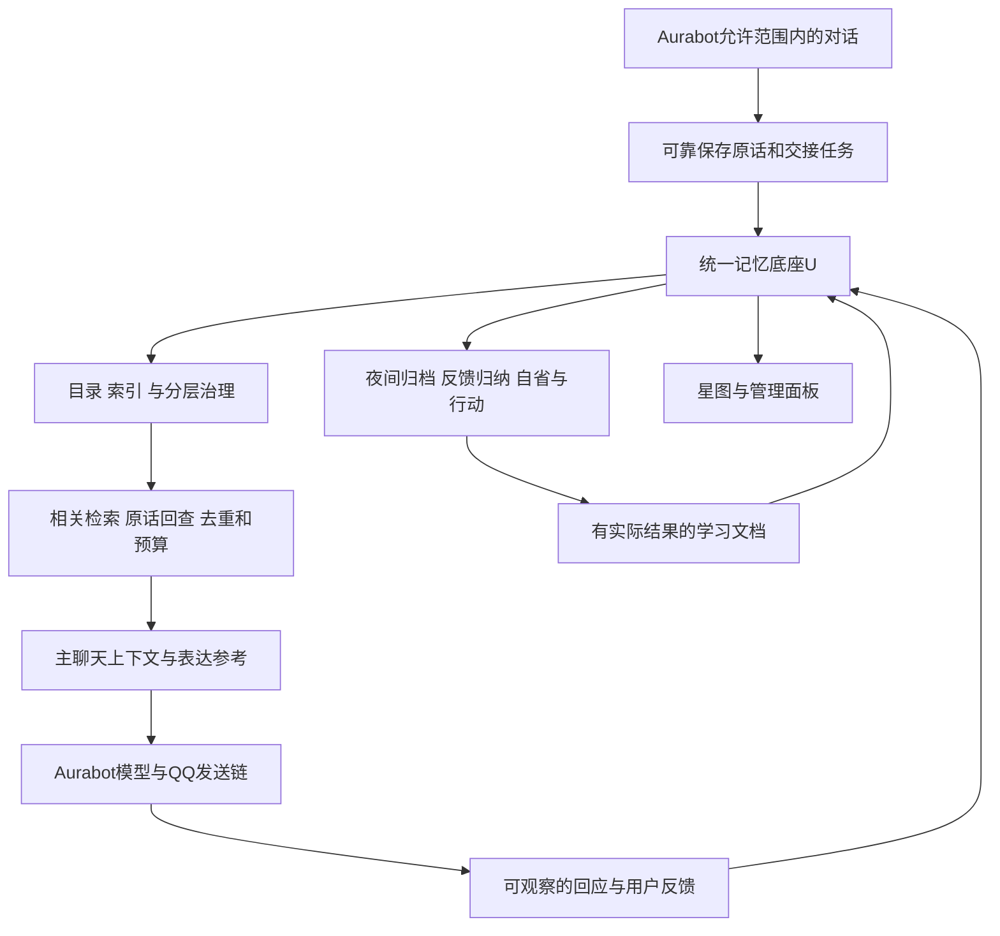

# Thinkstar 记忆系统项目说明

版本基准：**0.7.0** · 整理日期：**2026-11-20** · 模块标识：`thinkstar-memory`

本版新增[群聊专用生命周期](group-chat-lifecycle.md)及[原生注入协作](native-group-integration.md)。普通群聊按1/2/3/4天处理，废弃副本退出日常功能，重要记忆和私聊继续保护；原生memory及history-vault经配套适配接入，缺少原始对齐的旧画像／摘要暂留。旧配置默认关闭，实际启用以安装配置为准。

本说明依据当前源码、V5设计与既有版本验证记录整理。实现现状以代码和验证证据为准，不把设计目标或参考项目的能力直接列为本项目已完成的能力。

独立源码仓库：[rangesong/DSHaurabot-memory](https://github.com/rangesong/DSHaurabot-memory)。集合仓库：[rangesong/DSH](https://github.com/rangesong/DSH)，在 `plugins/thinkstar-memory` 中引用本插件的固定提交。版本与Release独立维护，获取方式见[仓库与发布说明](github-release.md)。

## 项目定位

**Thinkstar 记忆系统**是面向DeepSeek Harness（DSH）中Aurabot的长期记忆增强模块，围绕可靠保存、分层组织、来源追溯、情境召回、反馈修订和可视化管理展开。

它为大肥鱼提供独立、持久的记忆底座，并通过脑内三维星图展示记忆区域、处理通道、分层变化与运行轨迹。目标是在持续输入数月乃至数年的资料后，尽量保留重要事情的完整依据，并在合适的情境下找回相关细节。

模块以V5设计为基准。提供Aurabot原生用户模块与独立星图工作台，当前适配目标为Aurabot 1.3.0-beta.1 / 扩展API 1。

### 对QQ回复的实际作用

Thinkstar向Aurabot主聊天流程提供两类材料：

1. **记忆依据**：相关原话、经历、偏好、约定、事实版本和自主学习结果。
2. **表达参考**：来自明确纠正或多次独立互动的情境化建议，例如减少追问、调整详略或更贴近用户表达。

最终回答仍由Aurabot主聊天模型生成，并由原有发送流程发往QQ。记忆提供、模型请求、模型采用和消息投递是不同阶段，分别记录。

Thinkstar目前与原生 `memory` 协作，不是它的完整独立替代。两者保有各自数据库；观察到原生资料时，Thinkstar在已接入的范围内协调上下文，减少重复和标记冲突。这不等于合并物理存储，也不保证拦截所有其他模块的资料。

## 能力状态与后续工作

状态含义：**已实现**表示已有代码路径和相应验证；**条件可用**表示还依赖资源、配置、权限或检索命中；**待完善**表示能力尚未完整实现；**待验证**表示已有实现但证据不足以支持更大的结论。

| 能力 | 状态 | 当前范围与限制 |
|---|---|---|
| 原话可靠入库、来源和版本保存 | 已实现 | 按宿主实际提供的内容保存；上游已经截断的流水不能补造完整原话 |
| L0/L1/L2归档及相同输入复用 | 已实现 | 摘要作导航；模型整理需要许可与额度，不保证每次都由模型处理 |
| 重要记忆保护与普通遗忘恢复 | 已实现 | 自动治理受保护和依赖约束；明确隐私删除走不可普通恢复的路径 |
| 词法、实体、关系联想和原话回查 | 已实现 | 仍受范围、相关性、候选数量和上下文预算限制 |
| 本地语义召回 | 条件可用 | 需要宿主BGE模型资源；缺失时回退其他检索 |
| 按需模型重排 | 条件可用 | 默认关闭；需要允许DSH模型，会增加调用，超时回退 |
| 主聊天记忆与表达参考注入 | 已实现 | 已提供不代表模型必然使用；宿主边界和最终回执仍有缺口 |
| 双记忆模块上下文协调 | 已实现 | 仅协调可观察到、能够核对的原生资料，不合并两套数据库 |
| 自然反馈关联、解释修订和策略建议 | 已实现 | 模糊反馈可保持未知；模型解释是暂定，真实长期收益待持续观察 |
| 带条件的中枢准则 | 已实现 | 来源核对后启用，受允许参数、范围和版本约束，可暂停或撤回 |
| 夜间五轮调度与实际行动接口 | 条件可用 | 须功能开启、整理完成、模型工具可用且DSH运行；真实夜间效果待观察 |
| 实际学习结果入库并参与召回 | 条件可用 | 完成且有观察结果后入库；目前主要供同人格主人私聊使用，命中后供回复参考 |
| 自省策略闭环 | 已实现（范围受约束） | 从独立明确反馈发现问题，回放后试用简洁程度或追问压力；后续明确反馈验证、反例撤回，默认14天到期 |
| 三维星图、回放和参数管理 | 已实现 | 女孩外形还需要单独的私人GLB；脑区映射属于工程展示 |
| 关闭原生记忆后全功能等价 | 待完善 | 完整人物图谱、部分旧API等仍依赖或委托原生模块 |
| 多年自然运行下稳定找回重要事情 | 待验证 | 已有合成大库定向回查，不能替代实际连续运行或任意模糊问题验收 |
| 已提供→模型实际采用→QQ成功投递的完整证据 | 待完善 | 能记录部分请求和输出观察；未得到明确回执的阶段保持未知 |

后续工作应以明确验收结果推进：

| 方向 | 需要完善或验证的结果 |
|---|---|
| 自主学习的适用范围 | 现有两类表达策略已闭环；其他策略和真实长期收益仍需继续评估 |
| 隐式反馈理解 | 持续核对亲近、安慰、玩闹与不满的混淆，避免把自己的解释循环当新证据 |
| 长期召回与检索规模 | 在更大历史库中验证含糊线索、跨年重要事件和查询耗时；评估可重建的近似向量索引（ANN） |
| 宿主回执 | 在宿主提供能力时补全窗口余量、引用或采用及最终投递依据；不凭请求完成猜采用 |
| 原生兼容与删除同步 | 补足明确的接口功能矩阵、停用期变化与外部删除边界，再评估独立替代 |
| 资源与真实夜间效果 | 记录正常使用中的处理时间、模型调用及实际行动结果，验证收益是否足以抵消新增开销 |

这些项目是后续方向，不表示本次文档更新已经实现。

## 处理流程与存储结构



### 统一底座与三层归档

具体原话、记忆正文、经历、状态、来源与版本统一保存在Thinkstar自己的SQLite底座中。记忆组织区域保存目录、摘要和引用，命中后再回到底座读取内容。

| 归档层 | 内容 | 用途 |
|---|---|---|
| L0：完整原话 | 宿主提供的原始内容、身份、时间与来源 | 回查数字、约定、否定、修订和具体细节 |
| L1：日摘要 | 按日组织的导航性整理 | 定位某一天的经历和原文 |
| L2：月印象 | 按月汇总的导航内容 | 跨月份寻找长期经历线索 |

摘要不自动替代重要原证据。默认保留原文冷档；相同输入、处理方式和版本可以复用持久结果，分块结果和空结果也可复用，减少重复整理调用。容量为预算警戒，超过预算不静默丢弃新原话；真实写盘失败会明确报错。

跨会话保留主要指同一人格、同一聊天的资料可以跨越宿主会话持续存在。不同人格、私聊和群聊保有范围约束，不会无条件混合。人物停记和来源撤销在已接入路径中继续生效。

### 保护与版本

记忆保存重要程度和保护信号。P0/P1保护内容及其必要来源不走普通有损替代或自动淘汰路径；明确隐私删除不受这种保留约束阻拦。

近期内容先提交、立即可读，再后台交接。未完承诺不随时间自动完成，资料中“打算做”也不等于“已经做”。有明确版本依据时可优先现行值；不确定冲突保留双方并提示核对。

重复快照和大型引用采用共享与去重，修改前保全需要的历史载荷。这里的统一与去重发生在Thinkstar内部，不意味着原生记忆数据库也只保留一份。

## 五个工作中枢

名称与形状借鉴脑部结构，属于工程职责映射，不等同于复现生物大脑。

| 中枢 | 编号 | 职责 |
|---|---|---|
| 丘脑核群 | W1 | 接收输入、识别范围与保护信号，可靠提交后立即可读 |
| 前额皮层 | W2 | 调度目录和候选，维护当前选择及未完事项，装配上下文资料 |
| 杏仁核 | W3 | 输入初评、读后复评、情境互动与反馈建议 |
| 布罗卡区 | W4 | 组织面板表达及主聊天软策略，区分提议、准备与实际执行 |
| 海马体 | W5 | 经历归组、巩固、索引交接、压缩归档、重试和容量治理 |

每个中枢的管理栏目保留介绍、相关记忆、参数帮助和聚焦入口。中枢与记忆组织、底座及内隐准则之间存在处理通道。

## 四类记忆组织

| 组织 | 编号 | 组织依据 |
|---|---|---|
| 时间细胞 | M1 | 时间、阶段和版本顺序 |
| 情景记忆 | M2 | 项目、目标、完整经历与未完事项 |
| 人物图式 | M3 | 身份、条件偏好、支持与反例，不合并同名人物 |
| 共同基础 | M4 | 平台、群聊／私聊与明确话题链；时间仅参与排序 |

这些区域是寻找记忆的组织入口，不各自复制完整正文。对话空间由聊天和话题依据组织，不以时间段充当空间分类。

## 七种留存区域

三层归档解决分层读取，七种留存区域描述记忆的保留与处理状态，是两个不同维度。

| 区域 | 内容及作用 |
|---|---|
| 近事记忆 | 最近进入的完整内容，近期保护窗口内避免有损压缩 |
| 巩固记忆 | 完整温存或无损冷档，等待进一步分流 |
| 外显记忆 | 重要的准确内容和必要原证据 |
| 图式记忆 | 带条件、支持依据及反例的模式或行为准则 |
| 内隐记忆 | 核对后启用的条件准则，匹配时影响对应中枢允许的参数 |
| 前瞻记忆 | 承诺、计划、定时或条件触发事项；缺少真实结果时不当作完成 |
| 记忆残迹 | 普通低价值内容逐渐保留为要旨或线索，满足条件后退出活跃层 |

重要内容与普通衰退内容采用不同处理路径。形成图式不自动意味着接入内隐影响：中枢准则需要核对来源、版本和适用条件，可暂停、重核或撤回。前瞻记忆属于事项保存与状态管理，不保证Thinkstar独立执行任意定时任务或对外提醒。

## 检索、联想与上下文协调

系统结合词法（BM25）、实体、本地语义和已有关系寻找候选，再核对范围、有效性、重要程度与预算。

- **精确回查**：原话片段、数字、名称和特定事件可以进入词法检索；派生线索尽量回到完整原话。
- **语义召回**：复用宿主BGE-small中文int8模型，支持换说法的线索；资源不可用时回退其他路径。
- **有界联想**：受跳数、广度、权重、衰减和聊天范围约束，广泛经历不无条件扩展到无关话题。
- **可选重排**：默认关闭，使用DSH允许的模型对小批候选排序，不是另装的专用重排模型；超时采用原排序。
- **资料装配**：保留重要候选，减少同源重复，按照实际可用预算分配近期、状态、长期和共同语境材料。
- **双模块协调**：只对实际观察到且能识别的原生资料做去重和有限版本处理；未知冲突标记保留。

目前语义向量并非ANN索引，大库的任意模糊检索仍需验证。新索引主要夜间增量建立，未建好语义索引的新原话仍可由其他检索路径读取。

浏览、候选命中和仅进入请求不自动加深记忆。有效反馈可以有界调整可达性；加深不提高事实可信度，误解造成的相关增益可撤回。

上下文计量可参考DSH已有会话占用收缩记忆额度并预留回答空间；首次请求或信息不足时回退设置上限。模型请求完成不代表记忆实际采用或QQ投递成功。

## 反馈理解与情境学习

系统关联具体输入、回复和用户反应，分别保存情绪、表达、事实与任务维度。普通新问题、任务指令和日常回答尽量从反馈候选中排除。

“摸摸头”可表示亲近、安慰或玩闹，需要结合前后文暂定解释。宿主提供的表情标题或描述可作为资料，没有描述时不猜动作。含义不清保持待理解。

已实现的路径包括：

1. 绑定允许范围内的对话轮次，保存对应输入、回复和反应。
2. 进行本地分类；允许模型且有额度时，后台复核复杂语境。
3. 按来源根与轮次计算独立经历，避免同一次互动重复计数。
4. 在相似情境中形成较弱、可撤回的表达建议。
5. 支持人工修订解释，保留历史并撤回相关加深、停用依赖的旧印象。

默认至少3次独立且经复核的相似经历，才可能形成较稳定的个人表达知识。明确纠正与模糊亲近的权限不同；亲近不证明事实正确，催问不证明任务完成，当前明确要求优先于旧偏好。

复杂反馈白天可在后台小批复核，与夜间归纳共用每日额度，不阻塞主聊天。单次解释正确、建议进入请求，都不能单独证明长期回复质量提高。

## 夜间自省与自主行动

### 调度与实际执行

发布默认关闭；本机已获明确授权并启用。其他安装必须主动开启。总开关、参与记忆模式、允许DSH模型与夜间开关需要同时满足，DSH须保持运行，星图可以关闭。

| 设置 | 0.5.1安排 |
|---|---|
| 时间窗口 | 北京时间01:00–05:00，05:00为截止边界 |
| 前置条件 | 前一天有效版本归档、反馈整理完成，交接队列清空 |
| 每日轮数 | 最多5轮，失败也计入尝试次数 |
| 每轮行动数 | 默认最多1项 |
| 轮次间隔 | 从上一轮结束起至少20分钟，后台每分钟检查 |
| 单项等待 | 默认90秒，可调 |
| 重启和迟到 | 持久保存轮次，不重发结果未知的原轮次请求，不压缩间隔补跑 |

通用批量维护默认01:00–06:00；自主学习另受01:00–05:00限制，实际还需处于通用维护窗口内。没有前一天材料或没有新事项时可跳过；整理太晚不保证执行满5轮。

每轮结合真实经历自问当前想法、想做什么、想看什么和如何改善，再选择公开阅读、思考练习或自己的笔记任务。沿用宿主权限及工具，每项最多6次查询／阅读工具调用；可用时复用B站字幕、简介、热评及贴吧只读接口。

阅读取得工具结果才记为完成。工具不可用、只有模型自述、执行失败或跨截止，分别保留相应未完成状态。关闭功能或到达截止后停止后续工具调用，已提交远程请求不能保证立即取消计费。五轮不是五次模型调用上限。

不自动发送QQ消息、发表评论、购物、执行shell或修改其他系统。

### 学到的东西如何影响以后回复

| 产物 | 保存与作用 |
|---|---|
| 已完成行动的实际观察和摘要 | 作为明确标注的学习文档进入底座，可在同人格主人私聊中召回，命中并装入预算后供模型参考 |
| 自问自答、兴趣和暂定认识 | 自问与兴趣保持暂定；有多次明确反馈支持的问题，可另行形成受约束的表达策略试用 |
| 真实互动反馈形成的建议 | 经既有反馈路径，可影响以后相似情境的表达参考 |

这里是外部记忆与上下文学习，不训练基础模型权重。0.5.2已接通“发现问题→条件回放→试用→后续反馈→保留或撤回”，目前限于简洁程度和追问压力；不凭自省文字直接修改长期事实或权限。

## 三维星图与栏目

星图以用户提供的蓝发女仆GLB为角色框架，将所有区域放在头部空间。星点具有三维深度；淡红脑形雾气、独立分区雾团和神经通道帮助区分组织与处理路径。

已实现银河背景、明亮星点、局部名称、分层迁移、活动通道与运行回放；支持平移、旋转、缩放、进入脑内、区域聚焦、自动旋转、名称和模型显隐及二维视图。左右与底部面板可以收起。

女孩模型默认隐藏并可预载，使用已有按钮展示；资源失败不阻挡记忆核心。保留原文的退出活跃层与失去原文的遗忘轨迹分别呈现，后者可以使用流星效果，不将动画当作实际删除凭证。

主页面共有13个主栏目：

| 栏目 | 内容 |
|---|---|
| 星图 | 三维视图、显示操作与记忆总开关 |
| Thinkstar记忆 | 运行方式、聊天范围、模型许可与宿主上下文额度 |
| 记忆组织 | 四类目录，各有介绍、参数、关联记忆和聚焦入口 |
| 工作中枢 | 五个中枢及对应参数、记忆与条件规则 |
| 记忆系统 | 七种留存区域及相关记忆 |
| 印象 | 条件图式及可核对的支持、反例与规则信息 |
| 反馈与学习 | 反馈解释、修订历史、学习参数与后台复核 |
| 向量检索 | 本地语义召回参数及索引批次 |
| 联想与重排 | 联想范围、每轮召回量和可选模型重排 |
| 夜间自省与行动 | 功能开关、时间频次、行动额度与问答结果 |
| 最近活动 | 大肥鱼何时发生了哪些已观察到的互动 |
| 最近想起了什么 | 触发查询、提供的记忆及可观察请求阶段 |
| 运行状态与说明 | 工具、任务、维护、调参、异常、验证与说明，按时间排列 |

星图默认展开，其他主栏目及子栏目默认收起。标题使用语义相关的本地图标与不同颜色。栏目展开状态与功能开关独立：收起面板不等于停止记忆功能。

星图后台或收起时暂停实时动画及相关轮询，前台读取最新状态并恢复绘制；后台程序继续接收和召回。模型与页面尽量复用，减少反复打开的等待。

## 可调节能力

当前有**93项参数定义及对应解释**，不是93个独立AI能力。参数说明提供含义、作用及调高、调低的影响，支持保存、版本核对和配置回退。

| 类别 | 可调内容 | 作用方向 |
|---|---|---|
| 输入评价 | 目标关联、误丢代价、独特性和情绪加分 | 影响初评与普通内容的重要程度 |
| 召回规模 | 候选上限、每轮可选数量、目录路由数 | 平衡覆盖、上下文长度与处理开销 |
| 检索融合 | 词法、语义、实体及关联权重 | 改变不同线索的相对贡献 |
| 语义检索 | 开关、门槛和候选数 | 平衡换说法召回与噪声 |
| 联想扩展 | 跳数、广度、衰减和权重 | 控制关联范围与远距离扩展 |
| 候选重排 | 开关、候选数与等待上限 | 在额外调用与排序判断之间取舍 |
| 上下文 | 总预算及近期、状态、长期、共同语境份额 | 决定材料分配，仍受宿主上限约束 |
| 反馈学习 | 速度、独立经历门槛、关联窗口和单次调整上限 | 控制学习的及时性与保守程度 |
| 表达参考 | 详略、追问、语言贴近等 | 供内部评价、面板及条件策略使用，不是所有参数都强制控制QQ回复 |
| 留存治理 | 近期窗口、普通衰减、摘要比例和遗忘条件 | 控制普通资料的整理方式；不能绕过重要保护 |
| 后台维护 | 时间、批次、间隔、容量警戒和模型额度 | 控制后台处理节奏与开销 |
| 夜间行动 | 起止时间、轮数、间隔、每轮行动和时限 | 控制自主任务频次，仍受权限与维护窗口约束 |
| 星图显示 | 节点、关系、标签密度和聚焦增益 | 改变展示，不改变事实或真实记忆权重 |

部分代表参数的**代码默认值和范围**如下；用户已保存的有效配置可以不同：

| 参数 | 默认值 | 可调范围 |
|---|---:|---:|
| 每轮可选记忆数 | 6 | 1–24 |
| 候选上限 | 60 | 10–200 |
| 关系回忆跳数 | 2 | 0–4 |
| 语义相似度门槛 | 0.52 | 0.30–0.95 |
| 语义候选数 | 12 | 2–40 |
| 隐式反馈独立经历门槛 | 3 | 2–12 |
| 反馈关联窗口 | 30分钟 | 1–120分钟 |
| 每日自主学习轮数 | 5 | 1–12 |
| 自主轮次间隔 | 20分钟 | 5–180分钟 |
| 每轮自主行动上限 | 1 | 0–3 |
| 自主行动等待上限 | 90秒 | 30–180秒 |

宿主基础设置还提供每轮记忆上下文上限，界面范围为256–8192，未设置时默认1536；核心上下文及各份额另有参数。最终可装配内容同时受到宿主分配、当前占用、序列化开销及相关性约束。

控制分为功能开关、全局参数、带条件准则和视图选项。总开关关闭时停止Thinkstar新增记录、召回注入、维护、模型操作与后续自主工具调用，保留历史查看；不控制原生记忆开关。观察模式用于只积累和查看。

来源、范围、事实有效性和保护约束不能通过滑杆改变。表达策略只向模型提供参考，不能保证任意模型服从，也不能把所有界面参数等同已经证明的聊天收益。

## 遗忘、恢复与隐私删除

降低可达性、退出活跃层与明确删除是不同操作。默认保留L0冷档时，星点淡出日常检索不代表完整原话消失。

普通遗忘或废弃按规则保存可恢复材料，按照北京时间遗忘月份组织：

```text
modules-data/thinkstar-memory/
├─ memory.sqlite
├─ assets/                       # 可选私人女孩资源
└─ rubbishmemory/
   └─ 2026/
      └─ 2026-11.sqlite          # 示例：该月遗忘材料
```

垃圾桶可在治理面板预览和恢复，内容不自动重新进入上下文。有损整理或遗忘仍需保护必要来源；明确隐私删除会清除相关来源和派生依赖，不保留普通可恢复副本。

运行期公开接口已有删除与停记联动，停用期、绕过接口的改库及操作者另存备份仍有边界，不能承诺所有外部副本均已擦除。

## 资源、维护与发布

记忆核心和本地索引主要使用CPU、内存与磁盘；星图使用浏览器渲染能力。核心不要求独立显卡，模型计算消耗取决于DSH实际使用的模型服务。语义检索仍有本地计算，重排、自省与行动可能增加模型调用，当前没有可推广到所有使用方式的固定开销百分比。

本机主要源码与Release工作区为 `D:\GitHub\DSHaurabot-memory`，其他机器以克隆路径为准。代码按 `core`、宿主适配、服务、星图、共享布局、脚本与测试分工，具体入口见[README](../README.md)。

正式模块只写自己的数据目录。发布白名单排除聊天、SQLite、密钥、私人截图和女孩模型；女孩资源单独维护。代码更新器校验文件并保留旧代码备份，数据与资源保存在代码交换之外。

已有版本同步、静态检查、隔离测试、打包校验和GitHub Release草稿流程。云端检查与发行结果以实际运行记录为准，现有脚本或源码上传不等于已发布安装包。仓库公开可见不代表授予开源许可，第三方代码和素材保留各自许可。

当前存储结构为2，不兼容旧代码的回退需要配套一致性旧库备份。不要用多个实例同时写同一底座，也不要把代码回退当作已经撤销全部学习记录。

## 验证证据及其边界

0.5.1最近一轮隔离回归共262项：**261通过、1项私人GLB检查跳过、0失败**，覆盖前一天归档版本、北京时间边界、五轮额度、20分钟间隔、失败计次、重启、休眠、相同查询及跨截止状态。

此前进行了反馈历史副本核对、隔离DSH模型对比和三年等量历史定向回查。三年数据包含约44.3万条带每日时间戳的资料；定向跨年检查通过并不证明实际连续运行三年，也不证明所有含糊查询都正确。

0.5.2完整隔离回归共273项：272通过、1项私人GLB检查按预期跳过、0失败，并完成修复前、第一轮修复、第二轮优化的合成对比。没有开展真实QQ投递或说说发布，真实夜间与长期回复收益仍待持续观察。见[0.5.2对比与边界](upgrade-0.5.2.md)。

| 依据 | 用途 |
|---|---|
| [V5设计基准](design/v5.md) | 理解目标和结构；不能单凭设计条目判断完成 |
| [0.4.0记录](upgrade-0.4.0.md) | 检索、栏目、反馈学习与合成大库验证 |
| [0.5.0记录](upgrade-0.5.0.md) | 反馈修复、总开关、自主行动接口和隔离模型检查 |
| [0.5.1记录](upgrade-0.5.1.md) | 当前夜间频次、持久轮次与边界验证 |
| [参数定义](../core/v5-config.js)及[参数帮助](../core/v5-param-help.js) | 核对参数默认值、范围与解释 |
| [夜间实现](../core/v5-self-reflection.js) | 核对自问记录、实际学习入库与调度 |
| [Aurabot接入](../adapters/aurabot/module/lib/host-bridge.js) | 核对聊天范围、主流程资料注入及宿主边界 |
| [Release流程](github-release.md)及[第三方说明](../THIRD-PARTY-NOTICES.md) | 维护、发布与许可 |

以后功能或证据发生变化时，应同步更新本说明的状态表、README、V5设计及对应版本记录；不能仅移除限制文字就宣称能力已经完成。

## 0.7.0 经验自动成熟

独立反馈图式可在夜间自动进入内隐表达准则，保留同一规范ID与完整原证据。默认至少3次已复核的同情境独立经历，分布在2个北京时间自然日；先小幅试用，由后续新反馈验证。当前支持简洁程度、追问压力、贴近与接住安慰／玩闹的表达方式。面板提供默认收起的成熟与验证依据、暂停和撤回，暂停内容不通过普通召回或缓存继续参与表达。详细门槛、边界和恢复见[自动成熟设计](automatic-implicit-learning.md)。
